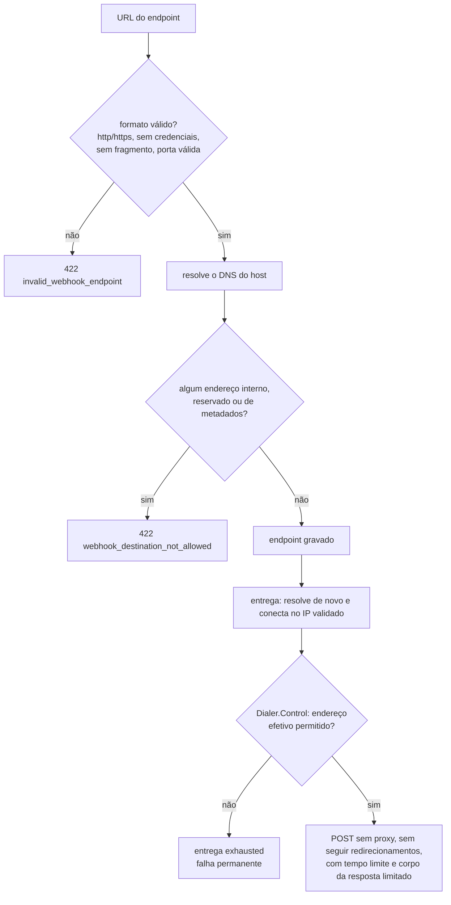

# Fluxos principais

## Faturamento recorrente

```mermaid
sequenceDiagram
  autonumber
  participant S as Agendador (worker)
  participant E as Motor de recorrência
  participant DB as PostgreSQL
  participant R as Relay da outbox
  participant MQ as RabbitMQ
  S->>DB: reivindica tarefa billing.run_cycle (lease, SKIP LOCKED)
  S->>E: RunAll
  E->>DB: app_tenants_with_due_billing(now) (somente IDs)
  loop por tenant e por assinatura vencida
    E->>DB: BEGIN; set_config(app.tenant_id); SELECT … FOR UPDATE SKIP LOCKED
    E->>E: NextStep → BuildCycleInvoice (fixo antecipado, consumo anterior, ajustes, desconto, crédito)
    E->>DB: número sequencial; INSERT fatura e itens; histórico; ledger (D contas a receber / C receita)
    E->>DB: outbox invoice.issued; auditoria; avança a assinatura; COMMIT
  end
  R->>DB: app_outbox_claim (lease)
  R->>MQ: publica (publisher confirm)
  R->>DB: app_outbox_mark_published
```

Garantias: assinatura reivindicada por uma instância de cada vez; índice único por assinatura e
período; numeração por linha bloqueada da sequência (sem lacunas); catch-up de até 24 períodos
por transação. Depois de uma reativação que pulou períodos inteiramente suspensos, o primeiro
passo fecha o consumo pendente anterior à suspensão (`pending_usage_starts`) no lugar do período
anterior regular e limpa a lista na mesma transação.

## Cobrança no provedor

```mermaid
sequenceDiagram
  autonumber
  participant C as Consumidor invoice.issued
  participant P as Pagamentos
  participant DB as PostgreSQL
  participant G as Provedor
  C->>P: HandleInvoiceIssued(tenant, fatura, mensagem)
  P->>DB: tx: cobrança pending + operação create_charge (referência = id da cobrança)
  P->>DB: tx curta: operação in_flight (lease > timeout da chamada)
  P->>G: (sem transação aberta) consulta por referência, se não for a 1ª tentativa
  P->>G: cria cliente/cobrança (checkout hospedado)
  alt sucesso
    P->>DB: cobrança awaiting_payment + checkout; operação succeeded; charge.created
  else recusa (4xx)
    P->>DB: cobrança failed; operação failed; charge.failed
  else falha repetível (conexão recusada, 503, 429)
    P->>DB: operação pending com backoff
  else ambígua (timeout, 5xx, resposta perdida)
    P->>DB: operação unknown com backoff
  end
  Note over P,G: A recuperação agendada consulta por referência antes de qualquer nova criação.<br/>Sem confirmação segura, a operação permanece unknown e aparece na conciliação.
  C->>DB: inbox (mensagem processada)
```

A cobrança acompanha o saldo vigente da fatura. A criação no provedor ocorre fora de transação e
pode levar tempo (timeout, retentativas, recuperação agendada); qualquer mudança de saldo nesse
intervalo, como nota de crédito ou pagamento manual parcial, leva à substituição na conclusão. Ao
registrar o resultado, o valor criado é comparado com o saldo da fatura: havendo divergência, a
cobrança é cancelada localmente e, na mesma transação, é gravada a nova cobrança pelo saldo (com
auditoria `charge.canceled_after_balance_change`), criada no provedor depois do commit; sem saldo, não
há substituta. A substituta segue o mesmo fluxo e pode ser substituída de novo. Quando a criação
termina dentro da própria solicitação (`RequestCharge`, inclusive pela nova tentativa
`POST /api/v1/invoices/{id}/charges`), a resposta é a cobrança vigente, isto é, a última
substituta. Depois de criada, a cobrança aguardando pagamento só é ajustada pela nota de crédito
(consumidor `payments.invoice_credited`). Toda cobrança cancelada no Recorvia com vínculo no provedor é
cancelada também no provedor (operação `cancel_charge`, ADR-037); um pagamento que ainda chegue pela
cobrança antiga (antes do cancelamento no provedor ou com ele falhando) continua sendo aplicado e o
excedente vira crédito do cliente.

## Webhook do provedor

```mermaid
sequenceDiagram
  autonumber
  participant G as Provedor
  participant A as API
  participant DB as PostgreSQL
  participant W as Consumidor de webhooks
  G->>A: POST /webhooks/providers/{provedor}/{token}
  A->>A: limite de 256 KiB, JSON válido
  A->>DB: app_resolve_webhook_endpoint(provedor, sha256(token)) → tenant, conta
  A->>A: autenticação do provedor (HMAC com timestamp no simulador; asaas-access-token no Asaas)
  A->>DB: tx: INSERT evento (único por provedor+id do evento) + outbox provider_webhook.received
  A-->>G: 200 (somente após persistir)
  W->>DB: lê evento e cobrança (sem lock)
  alt evento fora de ordem ou sem dados suficientes
    W->>G: GetCharge (situação autoritativa, sem transação aberta)
  end
  W->>DB: tx: inbox + cobrança FOR UPDATE + aplica situação sem regredir
  W->>DB: pagamento (único por cobrança), fatura, ledger (D liquidação, D taxas / C contas a receber, C liquidação), eventos, auditoria
```

A ordem de chegada não decide o estado: eventos com situação anterior à local são registrados sem
efeito; saltos (por exemplo, reembolso antes da confirmação) levam à consulta ao provedor.

Dinheiro recebido nunca é descartado: a confirmação de pagamento de cobrança `failed` (recusada) ou
`canceled` (cancelada só no Recorvia) leva a `paid` e segue a aplicação normal. O valor quita o
saldo da fatura e o excedente vira crédito do cliente; se a fatura já estiver paga ou cancelada, o
valor integral vira crédito. A taxa do provedor é sempre lançada no ledger, e a transição incomum é
auditada (`charge.paid_after_failure` ou `charge.paid_after_local_cancellation`).

## Ordem de bloqueio

Transações que alteram as mesmas linhas bloqueiam na mesma ordem, para se serializarem sem impasse:
cobrança, fatura, assinatura e cliente. O motor, as mudanças de assinatura, a correção de consumo e a
ingestão bloqueiam a assinatura antes do cliente (crédito consumido ou concedido). A aplicação de
pagamento segue a mesma ordem: cobrança e fatura (`FOR UPDATE`), depois a situação da assinatura
(`RefreshSubscriptionStanding`) e só então o crédito do excedente, que bloqueia o cliente. No
registro do resultado da criação, o vínculo do cliente no provedor (`customer_provider_refs`, cuja
chave estrangeira bloqueia a linha do cliente em modo compartilhado) é gravado depois da aplicação de
um pagamento já confirmado. Inserções com chave estrangeira para `customers` contam como bloqueio do
cliente nessa ordem.

Reembolsos, disputas e conciliação seguem a mesma ordem: o pedido e a confirmação de reembolso bloqueiam a
cobrança, depois o reembolso, a fatura (histórico) e por último o cliente (consumo de crédito). O registro
do resultado de uma operação externa bloqueia a operação e depois a cobrança; a sincronização feita sob o
bloqueio da cobrança (webhook) só altera operações que não estão em execução. A resolução de divergência
bloqueia a divergência antes da cobrança, e a execução da conciliação bloqueia as divergências antes de gravar
referências às cobranças.

## Nota de crédito

1. `POST /api/v1/invoices/{id}/credit-notes` com `Idempotency-Key`; a mesma chave devolve a nota já
   emitida.
2. Na transação: valida o limite (saldo em aberto), grava a nota (`credit_notes`, imutável,
   número `<fatura>-NCnn`), atualiza `amount_credited` da fatura, registra histórico, lança
   `revenue_adjustments` × `accounts_receivable` no ledger e grava `invoice.credited` na outbox
   (e `invoice.paid` quando o saldo zera).
3. O consumidor `payments.invoice_credited` cancela a cobrança aguardando pagamento com valor
   divergente (no Recorvia e, depois do commit, no provedor) e solicita nova cobrança pelo saldo
   atualizado. Pagamento que ainda chegue pela cobrança antiga é aplicado e o excedente vira crédito do
   cliente.
4. Se a cobrança ainda está em criação no provedor (`pending`), o consumidor apenas registra a
   mensagem. Ao concluir a operação de criação, o registro do resultado compara o valor criado com
   o saldo da fatura: havendo divergência, cancela a cobrança localmente, grava na mesma transação
   a nova cobrança pelo saldo (com auditoria `charge.canceled_after_balance_change`) e a cria no
   provedor depois do commit; uma falha nessa criação fica com a recuperação de operações. A mesma
   comparação vale para qualquer mudança de saldo durante a criação (ver "Cobrança no provedor").

## Ingestão de consumo

1. `POST /api/v1/usage-events` com até 500 eventos; resultado por evento (`accepted`, `duplicate`,
   `late` ou `rejected` com motivo).
2. `external_id` único por tenant: reenvio idêntico é `duplicate`; conteúdo diferente é rejeitado,
   inclusive quando o `external_id` se repete no mesmo lote. A deduplicação vem antes das validações
   que dependem do estado atual: o reenvio de um evento gravado é respondido pelo conteúdo, mesmo
   que a assinatura, o preço ou a métrica tenham mudado depois. `occurred_at` é truncado a
   microssegundos (precisão do `timestamptz`) antes de validar, gravar e comparar.
3. Validações: textos sem caractere NUL (nem UTF-8 inválido) e `properties` sem `\u0000`, unidade,
   quantidade decimal não negativa com até 6 casas e máximo por evento, `unique_key` para contagem
   distinta, instante dentro da vigência faturável e fora de suspensões (pelo histórico da
   assinatura, mesmo depois da reativação). Com o período aberto, a métrica precisa fazer parte da
   versão de preço que vai precificá-lo: a da mudança agendada pendente com data efetiva até o
   início do período (em vigor e ainda não aplicada pelo motor) ou, sem ela, a vigente. Período já
   fechado com agregado da métrica aceita o evento como `late` (dentro da tolerância), ainda que o
   plano tenha mudado. Período cujo fechamento já passou sem agregado da métrica, ou que nunca
   será fechado (inteiramente suspenso), rejeita o evento; o período em que a suspensão começou
   continua aberto depois da reativação até o primeiro faturamento após ela. Cliente anonimizado
   (ADR-061): todo evento novo é rejeitado com "Cliente anonimizado: consumo não é mais aceito.",
   antes das demais validações que dependem do estado atual; como a deduplicação vem antes, o
   reenvio de um evento já gravado continua respondido como `duplicate`. Rejeições valem por
   evento e não desfazem o lote.
4. O fechamento agrega por período conforme a métrica (`sum`, `max`, `unique_count`, `last`) e
   vincula o agregado ao item da fatura.
5. Ordem de bloqueio: no início da transação do lote, antes de qualquer outra leitura ou
   gravação, a ingestão bloqueia com `FOR SHARE` as assinaturas distintas do lote, uma vez cada e
   em ordem crescente de ID; só depois consulta métrica, deduplicação, cliente, mudança agendada
   e fechamento e grava os eventos. O cliente da assinatura é lido com `FOR KEY SHARE` (o mesmo
   bloqueio da chave estrangeira do evento), sempre depois dos bloqueios das assinaturas, uma vez
   por cliente no lote, no primeiro evento dele que passa pela deduplicação: é a primeira
   verificação de estado, feita antes das demais e da gravação, de modo que o bloqueio é tomado
   também quando o evento acaba rejeitado por outra regra (só não o tomam os eventos recusados
   antes disso: conteúdo inválido, assinatura ou métrica inexistente e reenvio de evento já
   gravado). A anonimização mantém o cliente com `FOR UPDATE` até confirmar e não bloqueia
   assinaturas: um lote que chega durante a anonimização espera nessa leitura, enxerga o cliente
   anonimizado e rejeita o evento, em vez de gravá-lo como `late` com a situação lida antes (a
   correção de consumo tentaria faturá-lo e a fatura seria recusada por
   `invoices_customer_guard`); uma anonimização que chega durante o lote espera o commit dele e
   avalia o faturamento pendente já com os eventos gravados. A mudança agendada é lida sem
   bloqueio: o agendamento e a aplicação pelo motor bloqueiam a assinatura com `FOR UPDATE` antes
   de alterá-la. O motor
   reivindica a assinatura com `FOR UPDATE SKIP LOCKED` e fecha o período na mesma transação:
   enquanto um lote mantém a assinatura, a reivindicação a pula (ela é faturada numa reivindicação
   seguinte); um lote que chega durante o fechamento espera o commit e classifica o evento como
   `late`, nunca como `accepted` num período já fechado. `FOR SHARE` é compatível entre lotes concorrentes; a ordem crescente (a
   mesma em que a correção de consumo percorre os grupos, bloqueando cada assinatura com
   `FOR UPDATE`) impede que transações que precisam de várias assinaturas as bloqueiem em ordens
   opostas.

## Reembolso

```mermaid
sequenceDiagram
  autonumber
  participant U as Usuário (payments.refund)
  participant A as API
  participant P as Pagamentos
  participant DB as PostgreSQL
  participant G as Provedor
  U->>A: POST /api/v1/charges/{id}/refunds (Idempotency-Key, valor, motivo)
  A->>P: RequestRefund(cobrança, valor, motivo, chave de negócio)
  P->>DB: tx: cobrança FOR UPDATE; chave do pedido; reserva amount_refund_pending; reembolso requested; operação refund; auditoria
  P->>DB: tx curta: bloqueio consultivo dos reembolsos da cobrança; operação in_flight (outro reembolso em execução adia esta)
  P->>G: (sem transação) consulta a cobrança se não for a 1ª tentativa; POST de reembolso com referência = ID do reembolso
  alt efetivado
    P->>DB: reembolso succeeded; reserva vira amount_refunded; crédito do cliente do excedente consumido; ledger refund.succeeded; histórico da fatura; refund.succeeded
  else aceito em processamento
    P->>DB: reembolso requested; operação succeeded (confirmação por webhook ou consulta)
  else recusa
    P->>DB: reembolso failed; reserva liberada; refund.failed
  else falha repetível (503, conexão recusada)
    P->>DB: reembolso requested; operação pending com backoff
  else ambígua (timeout, 5xx, resposta perdida)
    P->>DB: reembolso unknown; reserva mantida; operação unknown com backoff
  end
  A-->>U: 201 com o reembolso (requested, succeeded, failed ou unknown)
```

1. **Pedido.** A rota exige `payments.refund` e `Idempotency-Key`. A repetição com a mesma chave devolve a
   resposta registrada; depois da expurgação do registro HTTP (24 h), a chave de negócio
   (`refunds.request_key`) ainda devolve o mesmo reembolso. Mesma chave com outro conteúdo gera 409
   `idempotency_key_reused`; depois da expurgação do registro HTTP, a chave de negócio recusa outro valor
   ou outra cobrança com 409 `request_key_reused`. Com credencial de API, a autoria fica na auditoria
   (ator `api_credential`) e `requested_by` fica nulo.
2. **Saldo elegível.** O pedido bloqueia a cobrança e reserva o valor; pedidos concorrentes se serializam
   nesse bloqueio e o que não cabe no saldo recebe 409 `refund_exceeds_balance`. Somente cobranças `paid`
   ou `partially_refunded` aceitam reembolso (`charge_not_refundable` nas demais, inclusive em disputa), e
   um reembolso com resultado desconhecido bloqueia novos pedidos da mesma cobrança
   (`refund_outcome_unknown`, conflito transitório com `Retry-After`, que não fica registrado na
   `Idempotency-Key`). O banco garante que reembolsado, reservado e estornado nunca somam mais que o pago
   (`charges_refund_reservation_limit`, `charges_refund_limit`).
3. **Execução.** A chamada ao provedor ocorre logo após o commit, ainda na requisição; se não for possível
   (outro reembolso da cobrança em execução, provedor indisponível, processo interrompido), a operação fica
   com a recuperação (`payments.recover_operations`, a cada minuto no worker). A reivindicação de uma
   operação de reembolso toma um bloqueio consultivo por cobrança, de modo que duas instâncias nunca enviam
   ao mesmo tempo reembolsos da mesma cobrança (ADR-035). Pedido que ainda não chegou ao provedor quando a
   cobrança entra em disputa (ou é estornada por chargeback) não é enviado: o pagador receberia o valor
   duas vezes. O reembolso é encerrado como `failed` e a reserva liberada; pedido com tentativa anterior só
   consulta o provedor e é encerrado assim se o reembolso não constar nele.
4. **Confirmação.** Webhooks de reembolso (deduplicados, em qualquer ordem) e consultas ao provedor aplicam
   os reembolsos informados por associação exata (referência ou ID) ou, sem identificação, por valor
   (ADR-035); reembolsos feitos diretamente no provedor são registrados com `origin = 'provider'`. Os dados
   são cumulativos: um retrato mais antigo que chega depois não desfaz nem duplica efeitos. Webhook cujo
   retrato entra em conflito com o estado local (por exemplo, o crédito do cliente consumido por outra
   fatura ao mesmo tempo) não grava nenhum efeito: a transação é desfeita por inteiro e o webhook fica
   `ignored` com a causa, sem reserva presa; o próximo retrato do provedor aplica o reembolso.
5. **Efeitos.** A fatura não é reaberta: a devolução fica no histórico (`reason = 'refund'`), no ledger
   (`refund.succeeded`: débito em `refunds` ou, para o excedente do próprio pagamento, em
   `customer_credits`; crédito em `provider_clearing`) e no evento `refund.succeeded` (ADR-034). A parte do
   crédito é calculada com o crédito do cliente bloqueado (ordem: cobrança, fatura, cliente).

## Disputas e chargebacks

```mermaid
sequenceDiagram
  autonumber
  participant G as Provedor
  participant C as Consumidor payments.provider_webhooks
  participant P as Pagamentos
  participant DB as PostgreSQL
  G->>C: webhook de chargeback (via recepção, outbox e RabbitMQ)
  C->>P: ProcessWebhook (consulta o provedor quando o evento salta etapas)
  P->>DB: tx: inbox; cobrança FOR UPDATE; disputa aberta? (disputes_open_key)
  alt chargeback solicitado
    P->>DB: disputa opened pelo saldo não reembolsado nem estornado; cobrança disputed; ledger dispute.opened (retenção); dispute.opened
  else em análise
    P->>DB: disputa under_review; dispute_events
  else ganha
    P->>DB: disputa won; estorno da retenção; cobrança paid, partially_refunded ou refunded (conforme os reembolsos); dispute.closed
  else perdida
    P->>DB: disputa lost; amount_charged_back pelo saldo não reembolsado nem reservado; ledger dispute.hold_released (parte reembolsada); cobrança charged_back; histórico da fatura (chargeback); dispute.closed
  end
```

A situação de chargeback do provedor (webhook ou consulta) abre a disputa e retém o valor no ledger; a
decisão ganha estorna a retenção; a perdida mantém em `chargebacks` somente o valor estornado, sem reabrir a
fatura. O estorno não inclui o que foi devolvido ao pagador por reembolso confirmado durante a disputa
nem o que está reservado por reembolso em andamento; essa parte da retenção volta a `provider_clearing`
(`dispute.hold_released`), e a confirmação posterior do reembolso reservado cabe no saldo; se o reembolso
reservado for recusado depois da perda, o valor passa ao chargeback (`dispute.hold_restored`). Assim,
`chargebacks` e `refunds` nunca somam mais que o pago. Webhook
da decisão que chega antes do da abertura abre e decide a disputa na mesma transação; o da abertura, que
chega depois com retrato anterior, é ignorado. Eventos repetidos, fora de ordem ou anteriores ao
encerramento não reabrem disputas (ADR-036). Durante a disputa e depois do chargeback a cobrança não aceita
reembolso. `GET /api/v1/disputes` (`payments.read`) lista as disputas mais recentes.

## Cancelamento no provedor

1. A cobrança é cancelada no Recorvia (fatura cancelada, nota de crédito ou substituição na conclusão da
   criação) e, na mesma transação, é gravada a operação `cancel_charge` (única por cobrança).
2. Depois do commit, `CancelCharge` é chamado sem transação aberta, pelo consumidor que cancelou
   (`payments.invoice_voided`, `payments.invoice_credited`) ou pelo registro do resultado da criação;
   falhas ficam com a recuperação de operações, que consulta o provedor antes de repetir.
3. Cobrança inexistente no provedor equivale a cancelada. Cobrança já paga no provedor encerra a operação
   como falha e o pagamento é aplicado (ADR-030).

## Régua de cobrança e notificações

```mermaid
sequenceDiagram
  autonumber
  participant S as Agendador (worker)
  participant C as Régua (collections)
  participant DB as PostgreSQL
  participant N as Envio (notifications)
  participant M as SMTP
  S->>C: collections.run (lease)
  C->>DB: app_tenants_for_collections (somente IDs, em páginas; rodízio entre execuções)
  loop por fatura em aberto (páginas)
    C->>DB: tx: fatura FOR SHARE; passo mais recente alcançado; INSERT notificação (ON CONFLICT DO NOTHING)
  end
  loop por fatura vencida avulsa ou de assinatura fora de active e past_due
    C->>DB: tx: fatura FOR SHARE; inadimplência + invoice.overdue (uma vez)
  end
  loop por assinatura com fatura vencida (ou em past_due sem fatura vencida)
    C->>DB: tx: faturas vencidas FOR SHARE → assinatura FOR UPDATE
    C->>DB: inadimplência + invoice.overdue (uma vez); past_due ou volta a active; suspensão após N dias + aviso; reativação
  end
  S->>N: notifications.dispatch (lease)
  N->>DB: tx curta: notificações vencidas FOR UPDATE SKIP LOCKED; regras (resolução, contatos, janela, limite) → sending
  N->>M: envio fora de transação (tempo limite, TLS conforme configuração)
  N->>DB: tx (contexto desvinculado do job): sent | scheduled com backoff | failed (somente quem detém a tentativa)
```

O consumidor `collections.invoice_resolved` (eventos `invoice.paid`, `invoice.voided`,
`invoice.uncollectible` e `invoice.credited`) cancela os lembretes agendados da fatura resolvida,
registra a resolução da inadimplência e reavalia a assinatura (volta de `past_due` a `active` e
reativação pela política). Os
consumidores `notifications.invoice_issued`, `notifications.payment_confirmed` e
`notifications.member_invited` agendam os avisos de fatura emitida, pagamento recebido e convite de
membro (o token do convite chega cifrado no evento; ver ADR-044).

Configuração pela API (permissões `collections.read` e `collections.write`):

- `GET/POST /api/v1/collection-policies` e `PATCH /api/v1/collection-policies/{id}` (`If-Match`):
  passos relativos ao vencimento, janela de envio no fuso do tenant, limite diário por cliente,
  suspensão após N dias e reativação no pagamento. A primeira política é a padrão; marcar outra
  como padrão substitui a anterior. Na alteração, campos opcionais omitidos (`is_default`,
  `suspend_after_days`, `reactivate_on_payment`) mantêm o valor atual e `suspend_after_days: null`
  remove a suspensão.
- `GET /api/v1/notification-templates` e `PUT /api/v1/notification-templates/{key}`: assunto e
  corpo em texto simples com as variáveis da lista de cada template (`variables` traz os nomes;
  no texto, a marcação é `{{nome}}`).
- `GET /api/v1/notifications`: histórico paginado (filtros por situação e fatura) com
  destinatários, tentativas, último erro e instante de envio.

Criação e alteração de políticas e templates são auditadas. O worker publica as métricas
`recorvia_collection_actions_total{action}` (lembretes agendados, faturas vencidas, suspensões e
reativações) e `recorvia_notifications_dispatched_total{outcome}` (`sent`, `retried`, `failed`,
`deferred`, `skipped`, `lost_lease`), sem rótulos de tenant, cliente ou fatura.

## Webhooks enviados

```mermaid
sequenceDiagram
  autonumber
  participant MQ as RabbitMQ
  participant F as Fan-out (webhooks.fanout)
  participant DB as PostgreSQL
  participant D as Entregas (webhooks.deliver)
  participant T as Sistema do tenant
  MQ->>F: evento de domínio assinável
  F->>DB: tx: endpoints ativos que assinam o tipo; inbox; evento; uma entrega por endpoint
  D->>DB: tx curta: entregas vencidas FOR UPDATE SKIP LOCKED → delivering (lease); segredos válidos
  D->>D: assina id.timestamp.corpo com cada segredo válido (rotação)
  D->>T: POST (DNS validado, IP conferido na conexão, sem redirecionamento, limites)
  D->>DB: tx (contexto desvinculado do job): tentativa no histórico; succeeded | retrying (backoff com jitter) | exhausted
  D->>DB: orçamento esgotado ou endpoint sem resposta: entregas não tentadas voltam à fila
```

Configuração pela API (permissões `webhooks.read` e `webhooks.write`; todas as alterações são
auditadas, sem o valor dos segredos):

- `GET /api/v1/webhook-event-types`: eventos que podem ser assinados (eventos internos, como
  webhooks recebidos e convites, ficam de fora).
- `POST /api/v1/webhook-endpoints`: cria o endpoint e devolve o segredo (`whsec_...`) uma única vez;
  a listagem mostra apenas identificador e validade de cada segredo. A URL é validada no formato
  (http ou https conforme o ambiente, sem credenciais nem fragmento) e no destino (SSRF, abaixo).
- `PATCH /api/v1/webhook-endpoints/{id}` (`If-Match`): URL, descrição, eventos e situação; troca
  de URL ou reativação revalida o destino. `DELETE` desativa o endpoint, retira-o da listagem e
  encerra as entregas pendentes.
- `POST /api/v1/webhook-endpoints/{id}/rotate-secret`: novo segredo (exibido uma vez); os anteriores
  continuam válidos por `previous_secret_valid_hours` (padrão 24 h, 0 a 168).
- `GET /api/v1/webhook-endpoints/{id}/deliveries` e `POST /api/v1/webhook-deliveries/{id}/retry`:
  histórico paginado e reenvio manual (uma tentativa adicional imediata; recusado enquanto a
  entrega está pendente ou em andamento e para endpoint desativado).

Verificação pelo destinatário: recalcular `HMAC-SHA256(segredo, webhook-id + "." +
webhook-timestamp + "." + corpo)` (a chave é o base64 após o prefixo `whsec_`), aceitar se qualquer
assinatura `v1,` do cabeçalho `webhook-signature` conferir (comparação em tempo constante),
recusar `webhook-timestamp` fora de uma tolerância curta (por exemplo, 5 minutos) e deduplicar
pelo `webhook-id`, que é o mesmo em retentativas e reenvios. `webhooks.Verify` implementa a mesma
verificação. O worker publica `recorvia_webhook_deliveries_total{outcome}` (`succeeded`,
`retrying`, `exhausted`, `lost_lease`, `deferred`).

### Proteção contra SSRF



São recusados loopback, redes privadas, link-local, CGNAT, multicast, faixas reservadas e de
documentação, IPv4 embutido em NAT64 e qualquer resolução que inclua um desses endereços.
Endereços de metadados de nuvem (`169.254.169.254`, `fd00:ec2::254` e equivalentes) nunca são
aceitos. Exceções vêm somente de `RECORVIA_WEBHOOK_ALLOWED_PRIVATE_CIDRS`, proibida em produção,
onde também se exige https. A checagem na conexão fecha a janela entre a validação e a requisição
(DNS rebinding); um redirecionamento (3xx) é registrado como falha da tentativa, sem seguir o
destino informado.

## Conciliação

```mermaid
sequenceDiagram
  autonumber
  participant J as Job payments.reconcile ou usuário (reconciliation.run)
  participant P as Pagamentos
  participant DB as PostgreSQL
  participant G as Provedor
  J->>P: RunReconciliation(janela)
  P->>DB: tx: execução running (uma por conta, lease); encerra execuções interrompidas
  P->>G: ListCharges paginado (sem transação, dentro do prazo da coleta)
  P->>DB: cobranças listadas e depois as da janela (até o limite), cobranças do rodízio, reembolsos, operações unknown
  P->>G: GetCharge das locais ausentes da listagem e das cobranças do rodízio
  P->>P: Compare (pura): divergências por tipo e chave de deduplicação
  P->>DB: tx: grava/atualiza/reabre divergências; resolve automaticamente as não constatadas; registra as cobranças verificadas; conclui a execução
```

A conciliação compara cobranças, pagamentos, reembolsos e chargebacks locais com o provedor na janela e
registra divergências por tipo: cobrança sem correspondência (nos dois sentidos), valor ou taxa divergente,
pagamento não refletido, reembolso/chargeback pendente e operação com resultado desconhecido (ADR-038).
Além da janela, cada execução consulta individualmente um lote de cobranças criadas nos últimos 180 dias
que ainda podem mudar no provedor (aguardando pagamento, pagas, parcialmente reembolsadas ou em disputa), a
começar pelas nunca verificadas e pelas verificadas há mais tempo (rodízio): um chargeback ou reembolso
tardio com o webhook perdido aparece mesmo que o provedor não liste a cobrança na janela (o Asaas filtra a
listagem pela data de criação). O rodízio é de melhor esforço: a consulta que falha é pulada e a cobrança
volta na próxima execução, e o prazo da coleta, o cancelamento ou três falhas seguidas de provedor
indisponível interrompem só o rodízio, sem tornar a execução parcial nem fazê-la falhar.

- **Execução manual.** `POST /api/v1/reconciliation/runs` (`reconciliation.run`, `Idempotency-Key`) executa
  na requisição a janela padrão de 30 dias do provedor padrão e devolve a execução encerrada. A coleta não
  depende do prazo da requisição: tem prazo próprio de 40 segundos e, esgotado o prazo, a execução é
  concluída com o que foi coletado e com aviso de execução parcial em `error`. Falha do provedor encerra a
  execução como `failed`, com a causa em `error` (resposta 200); a repetição com a mesma chave devolve a
  mesma execução. Sem provedor padrão, 409 `provider_not_configured`; com outra execução em andamento na
  conta, 409 `reconciliation_running`, conflito transitório com `Retry-After` que não fica registrado na
  `Idempotency-Key` (a repetição com a mesma chave executa a conciliação depois que a outra execução
  terminar). Com credencial de API, `requested_by` fica nulo e a autoria fica na auditoria.
- **Execução parcial.** Limite de páginas da listagem ou de consultas individuais, prazo da coleta,
  limite de cobranças locais da janela (5000; as cobranças listadas pelo provedor vêm primeiro e nunca ficam
  de fora) ou de operações com resultado desconhecido (500) concluem a execução com aviso de execução
  parcial, que cita os motivos. O que não foi comparado não gera divergência nem tem divergência resolvida
  automaticamente; a divergência de operação que ficou fora da leitura só é resolvida quando a operação
  deixa de ter resultado desconhecido.
- **Execução agendada.** O job `payments.reconcile` (a cada hora, com lease do agendador) concilia, com
  janela de 7 dias, os tenants cujo plano da plataforma tem `reconciliation_automation`, com provedor padrão
  ativo e sem execução agendada nas últimas 24 horas.
- **Consulta.** `GET /api/v1/reconciliation/runs` e `GET /api/v1/reconciliation/discrepancies` (filtros
  `status` e `kind`) exigem `reconciliation.read`; o detalhe traz o histórico de auditoria da divergência
  (detecção, reabertura, resolução automática e resolução).
- **Resolução.** `POST /api/v1/reconciliation/discrepancies/{id}/resolve` exige `reconciliation.resolve`,
  justificativa de 10 a 2000 caracteres e uma ação aplicável ao tipo (`resolution_not_applicable` nas
  demais): `dismiss`, `keep_local`, `adjust_ledger` (lançamento `reconciliation.adjustment` pela diferença de
  taxa ou de valor pago) ou `accept_provider` (adota o provedor). Data, justificativa e lançamento ficam na
  divergência e na auditoria. O responsável fica sempre na auditoria, como ator do evento
  `reconciliation.discrepancy_resolved` do histórico da divergência (usuário da sessão ou credencial de
  API); na divergência, `resolved_by` guarda somente o usuário da sessão e fica nulo com credencial de API
  e na resolução automática (`auto_resolved`). A interface mostra o responsável a partir do histórico.
  Divergência já resolvida devolve 409 `discrepancy_not_open`; o provedor indisponível durante a resolução
  devolve 503.

## Worker: tarefas e métricas de recebíveis

| Tarefa ou consumidor | Efeito |
|---|---|
| `payments.provider_webhooks` | aplica pagamentos, reembolsos e disputas informados por webhook (inbox na mesma transação dos efeitos) |
| `payments.invoice_voided`, `payments.invoice_credited` | cancelam a cobrança em aberto no Recorvia e, depois do commit, no provedor |
| `payments.recover_operations` (1 min) | retoma operações `create_charge`, `refund` e `cancel_charge` pendentes, desconhecidas ou com lease expirado, sempre consultando o provedor antes de repetir |
| `payments.reconcile` (1 h) | conciliação agendada dos tenants elegíveis |
| `metrics.collect` (15 s) | `recorvia_reconciliation_open_discrepancies{kind}`, `recorvia_refunds_total{outcome}` e `recorvia_refunds_in_progress{status}` a partir de contagens agregadas do banco (ADR-039) |

Os eventos `refund.succeeded`, `refund.failed`, `dispute.opened`, `dispute.closed` e
`reconciliation.discrepancy_detected` são gravados na outbox na mesma transação dos efeitos e publicados no
RabbitMQ; nesta versão nenhum consumidor interno depende deles (ficam disponíveis para notificações e
webhooks enviados).

## Autenticação por credencial de API

```mermaid
sequenceDiagram
  autonumber
  participant I as Integração
  participant A as API
  participant R as Redis
  participant DB as PostgreSQL
  I->>A: Authorization: Bearer rcv_<identificador>_<segredo>
  A->>R: falhas recentes da origem (bloqueio após o limite)
  A->>A: valida o formato do token (sem consulta)
  A->>DB: app_find_api_credential(identificador) → tenant, credencial
  A->>DB: tx do tenant: credencial + organização + associação do emissor + plano
  A->>A: SHA-256 do segredo comparado em tempo constante (vigente e anterior)
  A->>DB: last_used_at (no máximo 1 escrita por minuto)
  A->>A: escopos efetivos = escopos ∩ permissões atuais do emissor
  A->>R: limite de taxa por credencial
  A->>A: rota restrita à sessão de usuário? → 403 user_session_required
  A->>A: X-Recorvia-Tenant (se enviado) = tenant da credencial; permissão da rota pelos escopos
  A->>DB: tx do tenant: alteração com autoria nula + auditoria (ator api_credential)
  A-->>I: resposta
```

Sem CSRF (o navegador não envia `Authorization: Bearer` por conta própria). O token do Recorvia tem
precedência sobre o cookie de sessão; outro `Authorization` (por exemplo, HTTP Basic de um proxy,
que o navegador repete) é ignorado quando há cookie e a requisição segue pela sessão, com CSRF. Token
malformado, desconhecido, revogado, expirado ou com segredo errado responde 401 com
`WWW-Authenticate: Bearer` e conta como tentativa inválida da origem. Organização inativa, plano sem
`api_access` ou emissor que deixou a organização respondem 403. A rotação mantém o identificador e
aceita o segredo anterior por 24 horas; a revogação vale na requisição seguinte.

Autoria (ADR-059): nas rotas que aceitam credencial, as colunas de autoria que referenciam `users`
(`created_by`, `updated_by`, `resolved_by` e afins) ficam nulas e a autoria fica na auditoria da
mesma transação, com o ator `api_credential`; o link do portal registra a credencial como autora.
Os atos que exigem uma pessoa identificada recusam a credencial com 403 `user_session_required`
antes da verificação de escopos: conta e sessão (inclusive `GET /api/v1/session`), gestão de membros
e convites, contratação de plano e de serviços adicionais da plataforma e gestão de credenciais,
inclusive a listagem `GET /api/v1/api-credentials`. Continuam disponíveis à credencial, pelos
escopos `members.read` e `platform_billing.read`, as leituras de membros, papéis e convites e as da
plataforma (visão geral, planos, serviços adicionais, pedidos e extratos). A lista das rotas
restritas à sessão, gerada a partir das rotas registradas, está na seção "Rotas restritas à sessão
de usuário" de [permissoes.md](permissoes.md).

## Portal do cliente

```mermaid
sequenceDiagram
  autonumber
  participant U as Usuário do tenant
  participant C as Cliente
  participant A as API
  participant DB as PostgreSQL
  participant R as Redis
  U->>A: POST /api/v1/customers/{id}/portal-links
  A->>DB: tx: cliente FOR NO KEY UPDATE; revoga links anteriores; grava hash do novo token; auditoria
  A-->>U: URL /portal/access?token=… e expires_at (token exibido uma vez)
  C->>A: GET /portal/access?token=…
  A->>R: falhas recentes da origem
  A->>DB: app_find_portal_link(sha256(token)) → tenant, link
  A->>DB: tx: link FOR UPDATE (pendente e dentro da validade); cliente e organização ativos; used_at; auditoria (customer_portal)
  A->>R: grava a sessão do portal (antes do commit; descartada se o commit falhar)
  A-->>C: 302 /portal + cookie recorvia_portal (HttpOnly, SameSite=Strict, Secure conforme ambiente)
  C->>A: /api/portal/v1/* com o cookie (X-CSRF-Token nos métodos que alteram estado)
  A->>R: sessão (expiração absoluta e por inatividade)
  A->>DB: tx do tenant da sessão: link não revogado, cliente e organização ativos
  C->>A: GET /api/portal/v1/invoices, /invoices/{id}, /invoices/{id}/document
  A->>DB: tx do tenant da sessão: faturas emitidas do cliente da sessão (tenant_id e customer_id), itens e link de pagamento em aberto
  A-->>C: faturas do cliente (outro cliente, outro tenant ou rascunho: 404)
  C->>A: PUT /api/portal/v1/contact-preferences (X-CSRF-Token)
  A->>DB: tx: cliente bloqueado; contatos do próprio cliente; grava só o que mudou; auditoria (customer_portal)
  C->>A: POST /api/portal/v1/logout (X-CSRF-Token)
  A->>DB: auditoria do encerramento
  A->>R: remove a sessão
  A-->>C: 204 + cookie expirado
```

Um novo link para o mesmo cliente revoga o anterior e encerra a sessão aberta com ele; arquivar o
cliente ou suspender a organização também encerra o acesso. O portal não aceita a sessão do painel
nem credenciais de API.

O cliente vê as 100 faturas emitidas mais recentes, sem histórico, cobranças ou identificadores
internos; os itens aparecem pelo valor líquido do desconto. O botão de pagamento usa o link do
pagamento hospedado da cobrança mais recente aguardando pagamento e só aparece para fatura em
aberto com saldo. O documento comercial é o mesmo HTML do painel, exibido em `iframe` isolado; a
baixa como incobrável aparece ao cliente como "Encerrada". Nas
preferências, o cliente escolhe quais contatos recebem e-mails de cobrança; contatos de outro
cliente respondem 404 e nada da requisição é aplicado. Rascunhos e faturas de outros clientes nunca
são consultados: as consultas do portal filtram tenant e cliente.
