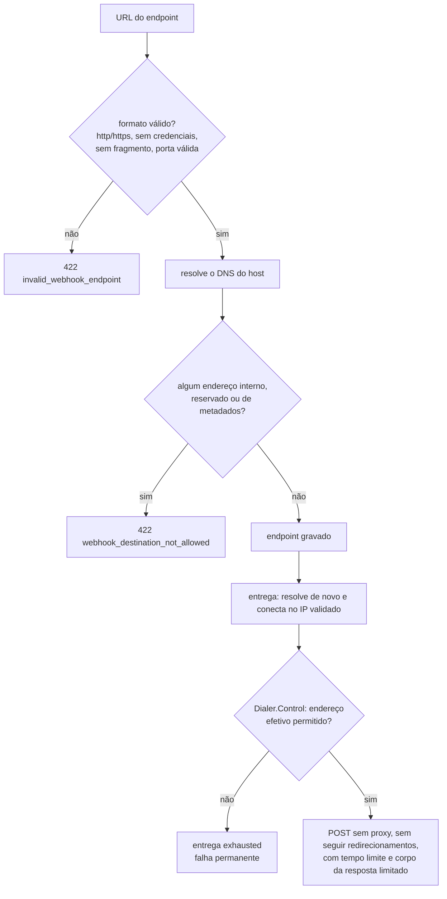

# Fluxos principais

## Faturamento recorrente

```mermaid
sequenceDiagram
  autonumber
  participant S as Agendador (worker)
  participant E as Motor de recorrência
  participant DB as PostgreSQL
  participant R as Relay da outbox
  participant MQ as RabbitMQ
  S->>DB: reivindica tarefa billing.run_cycle (lease, SKIP LOCKED)
  S->>E: RunAll
  E->>DB: app_tenants_with_due_billing(now) (somente IDs)
  loop por tenant e por assinatura vencida
    E->>DB: BEGIN; set_config(app.tenant_id); SELECT … FOR UPDATE SKIP LOCKED
    E->>E: NextStep → BuildCycleInvoice (fixo antecipado, consumo anterior, ajustes, desconto, crédito)
    E->>DB: número sequencial; INSERT fatura e itens; histórico; ledger (D contas a receber / C receita)
    E->>DB: outbox invoice.issued; auditoria; avança a assinatura; COMMIT
  end
  R->>DB: app_outbox_claim (lease)
  R->>MQ: publica (publisher confirm)
  R->>DB: app_outbox_mark_published
```

Garantias: assinatura reivindicada por uma instância de cada vez; índice único por assinatura e
período; numeração por linha bloqueada da sequência (sem lacunas); catch-up de até 24 períodos
por transação. Depois de uma reativação que pulou períodos inteiramente suspensos, o primeiro
passo fecha o consumo pendente anterior à suspensão (`pending_usage_starts`) no lugar do período
anterior regular e limpa a lista na mesma transação.

## Cobrança no provedor

```mermaid
sequenceDiagram
  autonumber
  participant C as Consumidor invoice.issued
  participant P as Pagamentos
  participant DB as PostgreSQL
  participant G as Provedor
  C->>P: HandleInvoiceIssued(tenant, fatura, mensagem)
  P->>DB: tx: cobrança pending + operação create_charge (referência = id da cobrança)
  P->>DB: tx curta: operação in_flight (lease > timeout da chamada)
  P->>G: (sem transação aberta) consulta por referência, se não for a 1ª tentativa
  P->>G: cria cliente/cobrança (checkout hospedado)
  alt sucesso
    P->>DB: cobrança awaiting_payment + checkout; operação succeeded; charge.created
  else recusa (4xx)
    P->>DB: cobrança failed; operação failed; charge.failed
  else falha repetível (conexão recusada, 503, 429)
    P->>DB: operação pending com backoff
  else ambígua (timeout, 5xx, resposta perdida)
    P->>DB: operação unknown com backoff
  end
  Note over P,G: A recuperação agendada consulta por referência antes de qualquer nova criação.<br/>Sem confirmação segura, a operação permanece unknown e aparece na conciliação.
  C->>DB: inbox (mensagem processada)
```

A cobrança acompanha o saldo vigente da fatura. A criação no provedor ocorre fora de transação e
pode levar tempo (timeout, retentativas, recuperação agendada); qualquer mudança de saldo nesse
intervalo, como nota de crédito ou pagamento manual parcial, leva à substituição na conclusão. Ao
registrar o resultado, o valor criado é comparado com o saldo da fatura: havendo divergência, a
cobrança é cancelada localmente e, na mesma transação, é gravada a nova cobrança pelo saldo (com
auditoria `charge.canceled_after_balance_change`), criada no provedor depois do commit; sem saldo, não
há substituta. A substituta segue o mesmo fluxo e pode ser substituída de novo. Quando a criação
termina dentro da própria solicitação (`RequestCharge`, inclusive pela nova tentativa
`POST /api/v1/invoices/{id}/charges`), a resposta é a cobrança vigente, isto é, a última
substituta. Depois de criada, a cobrança aguardando pagamento só é ajustada pela nota de crédito
(consumidor `payments.invoice_credited`); um pagamento pela cobrança antiga continua sendo aplicado e
o excedente vira crédito do cliente.

## Webhook do provedor

```mermaid
sequenceDiagram
  autonumber
  participant G as Provedor
  participant A as API
  participant DB as PostgreSQL
  participant W as Consumidor de webhooks
  G->>A: POST /webhooks/providers/{provedor}/{token}
  A->>A: limite de 256 KiB, JSON válido
  A->>DB: app_resolve_webhook_endpoint(provedor, sha256(token)) → tenant, conta
  A->>A: autenticação do provedor (HMAC com timestamp no simulador; asaas-access-token no Asaas)
  A->>DB: tx: INSERT evento (único por provedor+id do evento) + outbox provider_webhook.received
  A-->>G: 200 (somente após persistir)
  W->>DB: lê evento e cobrança (sem lock)
  alt evento fora de ordem ou sem dados suficientes
    W->>G: GetCharge (situação autoritativa, sem transação aberta)
  end
  W->>DB: tx: inbox + cobrança FOR UPDATE + aplica situação sem regredir
  W->>DB: pagamento (único por cobrança), fatura, ledger (D liquidação, D taxas / C contas a receber, C liquidação), eventos, auditoria
```

A ordem de chegada não decide o estado: eventos com situação anterior à local são registrados sem
efeito; saltos (por exemplo, reembolso antes da confirmação) levam à consulta ao provedor.

Dinheiro recebido nunca é descartado: a confirmação de pagamento de cobrança `failed` (recusada) ou
`canceled` (cancelada só no Recorvia) leva a `paid` e segue a aplicação normal. O valor quita o
saldo da fatura e o excedente vira crédito do cliente; se a fatura já estiver paga ou cancelada, o
valor integral vira crédito. A taxa do provedor é sempre lançada no ledger, e a transição incomum é
auditada (`charge.paid_after_failure` ou `charge.paid_after_local_cancellation`).

## Ordem de bloqueio

Transações que alteram as mesmas linhas bloqueiam na mesma ordem, para se serializarem sem impasse:
cobrança, fatura, assinatura e cliente. O motor, as mudanças de assinatura, a correção de consumo e a
ingestão bloqueiam a assinatura antes do cliente (crédito consumido ou concedido). A aplicação de
pagamento segue a mesma ordem: cobrança e fatura (`FOR UPDATE`), depois a situação da assinatura
(`RefreshSubscriptionStanding`) e só então o crédito do excedente, que bloqueia o cliente. No
registro do resultado da criação, o vínculo do cliente no provedor (`customer_provider_refs`, cuja
chave estrangeira bloqueia a linha do cliente em modo compartilhado) é gravado depois da aplicação de
um pagamento já confirmado. Inserções com chave estrangeira para `customers` contam como bloqueio do
cliente nessa ordem.

## Nota de crédito

1. `POST /api/v1/invoices/{id}/credit-notes` com `Idempotency-Key`; a mesma chave devolve a nota já
   emitida.
2. Na transação: valida o limite (saldo em aberto), grava a nota (`credit_notes`, imutável,
   número `<fatura>-NCnn`), atualiza `amount_credited` da fatura, registra histórico, lança
   `revenue_adjustments` × `accounts_receivable` no ledger e grava `invoice.credited` na outbox
   (e `invoice.paid` quando o saldo zera).
3. O consumidor `payments.invoice_credited` cancela localmente a cobrança aguardando pagamento
   com valor divergente e solicita nova cobrança pelo saldo atualizado. Pagamento que ainda chegue
   pela cobrança antiga é aplicado e o excedente vira crédito do cliente.
4. Se a cobrança ainda está em criação no provedor (`pending`), o consumidor apenas registra a
   mensagem. Ao concluir a operação de criação, o registro do resultado compara o valor criado com
   o saldo da fatura: havendo divergência, cancela a cobrança localmente, grava na mesma transação
   a nova cobrança pelo saldo (com auditoria `charge.canceled_after_balance_change`) e a cria no
   provedor depois do commit; uma falha nessa criação fica com a recuperação de operações. A mesma
   comparação vale para qualquer mudança de saldo durante a criação (ver "Cobrança no provedor").

## Ingestão de consumo

1. `POST /api/v1/usage-events` com até 500 eventos; resultado por evento (`accepted`, `duplicate`,
   `late` ou `rejected` com motivo).
2. `external_id` único por tenant: reenvio idêntico é `duplicate`; conteúdo diferente é rejeitado,
   inclusive quando o `external_id` se repete no mesmo lote. A deduplicação vem antes das validações
   que dependem do estado atual: o reenvio de um evento gravado é respondido pelo conteúdo, mesmo
   que a assinatura, o preço ou a métrica tenham mudado depois. `occurred_at` é truncado a
   microssegundos (precisão do `timestamptz`) antes de validar, gravar e comparar.
3. Validações: textos sem caractere NUL (nem UTF-8 inválido) e `properties` sem `\u0000`, unidade,
   quantidade decimal não negativa com até 6 casas e máximo por evento, `unique_key` para contagem
   distinta, instante dentro da vigência faturável e fora de suspensões (pelo histórico da
   assinatura, mesmo depois da reativação). Com o período aberto, a métrica precisa fazer parte da
   versão de preço que vai precificá-lo: a da mudança agendada pendente com data efetiva até o
   início do período (em vigor e ainda não aplicada pelo motor) ou, sem ela, a vigente. Período já
   fechado com agregado da métrica aceita o evento como `late` (dentro da tolerância), ainda que o
   plano tenha mudado. Período cujo fechamento já passou sem agregado da métrica, ou que nunca
   será fechado (inteiramente suspenso), rejeita o evento; o período em que a suspensão começou
   continua aberto depois da reativação até o primeiro faturamento após ela. Rejeições valem por
   evento e não desfazem o lote.
4. O fechamento agrega por período conforme a métrica (`sum`, `max`, `unique_count`, `last`) e
   vincula o agregado ao item da fatura.
5. Ordem de bloqueio: no início da transação do lote, antes de qualquer outra leitura ou
   gravação, a ingestão bloqueia com `FOR SHARE` as assinaturas distintas do lote, uma vez cada e
   em ordem crescente de ID; só depois consulta métrica, mudança agendada, deduplicação e
   fechamento e grava os eventos. A mudança agendada é lida sem bloqueio: o agendamento e a
   aplicação pelo motor bloqueiam a assinatura com `FOR UPDATE` antes de alterá-la. O motor
   reivindica a assinatura com `FOR UPDATE SKIP LOCKED` e fecha o período na mesma transação:
   enquanto um lote mantém a assinatura, a reivindicação a pula (ela é faturada numa reivindicação
   seguinte); um lote que chega durante o fechamento espera o commit e classifica o evento como
   `late`, nunca como `accepted` num período já fechado. `FOR SHARE` é compatível entre lotes concorrentes; a ordem crescente (a
   mesma em que a correção de consumo percorre os grupos, bloqueando cada assinatura com
   `FOR UPDATE`) impede que transações que precisam de várias assinaturas as bloqueiem em ordens
   opostas.

## Régua de cobrança e notificações

```mermaid
sequenceDiagram
  autonumber
  participant S as Agendador (worker)
  participant C as Régua (collections)
  participant DB as PostgreSQL
  participant N as Envio (notifications)
  participant M as SMTP
  S->>C: collections.run (lease)
  C->>DB: app_tenants_for_collections (somente IDs, em páginas; rodízio entre execuções)
  loop por fatura em aberto (páginas)
    C->>DB: tx: fatura FOR SHARE; passo mais recente alcançado; INSERT notificação (ON CONFLICT DO NOTHING)
  end
  loop por fatura vencida avulsa ou de assinatura fora de active e past_due
    C->>DB: tx: fatura FOR SHARE; inadimplência + invoice.overdue (uma vez)
  end
  loop por assinatura com fatura vencida (ou em past_due sem fatura vencida)
    C->>DB: tx: faturas vencidas FOR SHARE → assinatura FOR UPDATE
    C->>DB: inadimplência + invoice.overdue (uma vez); past_due ou volta a active; suspensão após N dias + aviso; reativação
  end
  S->>N: notifications.dispatch (lease)
  N->>DB: tx curta: notificações vencidas FOR UPDATE SKIP LOCKED; regras (resolução, contatos, janela, limite) → sending
  N->>M: envio fora de transação (tempo limite, TLS conforme configuração)
  N->>DB: tx (contexto desvinculado do job): sent | scheduled com backoff | failed (somente quem detém a tentativa)
```

O consumidor `collections.invoice_resolved` (eventos `invoice.paid`, `invoice.voided`,
`invoice.uncollectible` e `invoice.credited`) cancela os lembretes agendados da fatura resolvida,
registra a resolução da inadimplência e reavalia a assinatura (volta de `past_due` a `active` e
reativação pela política). Os
consumidores `notifications.invoice_issued`, `notifications.payment_confirmed` e
`notifications.member_invited` agendam os avisos de fatura emitida, pagamento recebido e convite de
membro (o token do convite chega cifrado no evento; ver ADR-044).

Configuração pela API (permissões `collections.read` e `collections.write`):

- `GET/POST /api/v1/collection-policies` e `PATCH /api/v1/collection-policies/{id}` (`If-Match`):
  passos relativos ao vencimento, janela de envio no fuso do tenant, limite diário por cliente,
  suspensão após N dias e reativação no pagamento. A primeira política é a padrão; marcar outra
  como padrão substitui a anterior. Na alteração, campos opcionais omitidos (`is_default`,
  `suspend_after_days`, `reactivate_on_payment`) mantêm o valor atual e `suspend_after_days: null`
  remove a suspensão.
- `GET /api/v1/notification-templates` e `PUT /api/v1/notification-templates/{key}`: assunto e
  corpo em texto simples com as variáveis da lista de cada template (`variables` traz os nomes;
  no texto, a marcação é `{{nome}}`).
- `GET /api/v1/notifications`: histórico paginado (filtros por situação e fatura) com
  destinatários, tentativas, último erro e instante de envio.

Criação e alteração de políticas e templates são auditadas. O worker publica as métricas
`recorvia_collection_actions_total{action}` (lembretes agendados, faturas vencidas, suspensões e
reativações) e `recorvia_notifications_dispatched_total{outcome}` (`sent`, `retried`, `failed`,
`deferred`, `skipped`, `lost_lease`), sem rótulos de tenant, cliente ou fatura.

## Webhooks enviados

```mermaid
sequenceDiagram
  autonumber
  participant MQ as RabbitMQ
  participant F as Fan-out (webhooks.fanout)
  participant DB as PostgreSQL
  participant D as Entregas (webhooks.deliver)
  participant T as Sistema do tenant
  MQ->>F: evento de domínio assinável
  F->>DB: tx: endpoints ativos que assinam o tipo; inbox; evento; uma entrega por endpoint
  D->>DB: tx curta: entregas vencidas FOR UPDATE SKIP LOCKED → delivering (lease); segredos válidos
  D->>D: assina id.timestamp.corpo com cada segredo válido (rotação)
  D->>T: POST (DNS validado, IP conferido na conexão, sem redirecionamento, limites)
  D->>DB: tx (contexto desvinculado do job): tentativa no histórico; succeeded | retrying (backoff com jitter) | exhausted
  D->>DB: orçamento esgotado ou endpoint sem resposta: entregas não tentadas voltam à fila
```

Configuração pela API (permissões `webhooks.read` e `webhooks.write`; todas as alterações são
auditadas, sem o valor dos segredos):

- `GET /api/v1/webhook-event-types`: eventos que podem ser assinados (eventos internos, como
  webhooks recebidos e convites, ficam de fora).
- `POST /api/v1/webhook-endpoints`: cria o endpoint e devolve o segredo (`whsec_...`) uma única vez;
  a listagem mostra apenas identificador e validade de cada segredo. A URL é validada no formato
  (http ou https conforme o ambiente, sem credenciais nem fragmento) e no destino (SSRF, abaixo).
- `PATCH /api/v1/webhook-endpoints/{id}` (`If-Match`): URL, descrição, eventos e situação; troca
  de URL ou reativação revalida o destino. `DELETE` desativa o endpoint, retira-o da listagem e
  encerra as entregas pendentes.
- `POST /api/v1/webhook-endpoints/{id}/rotate-secret`: novo segredo (exibido uma vez); os anteriores
  continuam válidos por `previous_secret_valid_hours` (padrão 24 h, 0 a 168).
- `GET /api/v1/webhook-endpoints/{id}/deliveries` e `POST /api/v1/webhook-deliveries/{id}/retry`:
  histórico paginado e reenvio manual (uma tentativa adicional imediata; recusado enquanto a
  entrega está pendente ou em andamento e para endpoint desativado).

Verificação pelo destinatário: recalcular `HMAC-SHA256(segredo, webhook-id + "." +
webhook-timestamp + "." + corpo)` (a chave é o base64 após o prefixo `whsec_`), aceitar se qualquer
assinatura `v1,` do cabeçalho `webhook-signature` conferir (comparação em tempo constante),
recusar `webhook-timestamp` fora de uma tolerância curta (por exemplo, 5 minutos) e deduplicar
pelo `webhook-id`, que é o mesmo em retentativas e reenvios. `webhooks.Verify` implementa a mesma
verificação. O worker publica `recorvia_webhook_deliveries_total{outcome}` (`succeeded`,
`retrying`, `exhausted`, `lost_lease`, `deferred`).

### Proteção contra SSRF



São recusados loopback, redes privadas, link-local, CGNAT, multicast, faixas reservadas e de
documentação, IPv4 embutido em NAT64 e qualquer resolução que inclua um desses endereços.
Endereços de metadados de nuvem (`169.254.169.254`, `fd00:ec2::254` e equivalentes) nunca são
aceitos. Exceções vêm somente de `RECORVIA_WEBHOOK_ALLOWED_PRIVATE_CIDRS`, proibida em produção,
onde também se exige https. A checagem na conexão fecha a janela entre a validação e a requisição
(DNS rebinding); um redirecionamento (3xx) é registrado como falha da tentativa, sem seguir o
destino informado.

## Conciliação

A conciliação compara cobranças locais com o provedor na janela de datas e registra divergências
abertas por tipo: cobrança sem correspondência, valor ou taxa divergente, pagamento não refletido,
reembolso/chargeback pendente e operação com resultado desconhecido. A resolução exige permissão
`reconciliation.resolve`, justificativa e gera histórico e, quando necessário, lançamento de ajuste
no ledger. O estado atual desta funcionalidade está em `docs/STATUS.md`.
