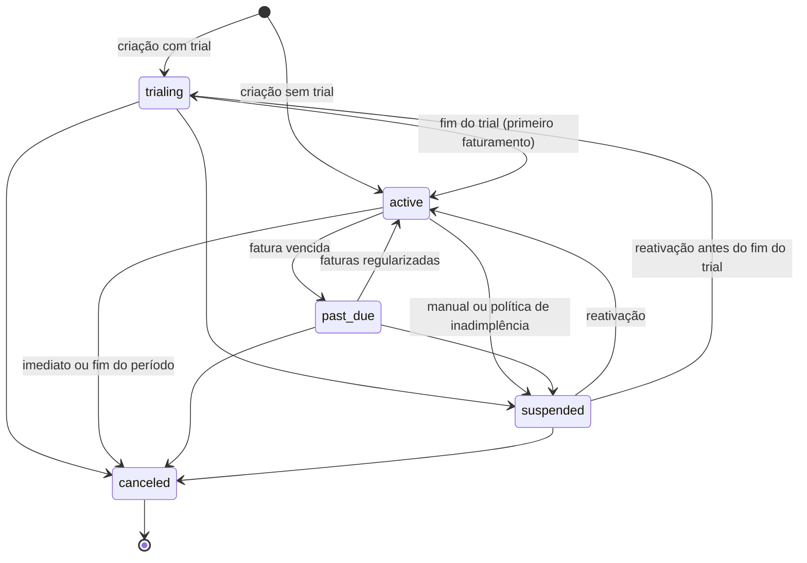
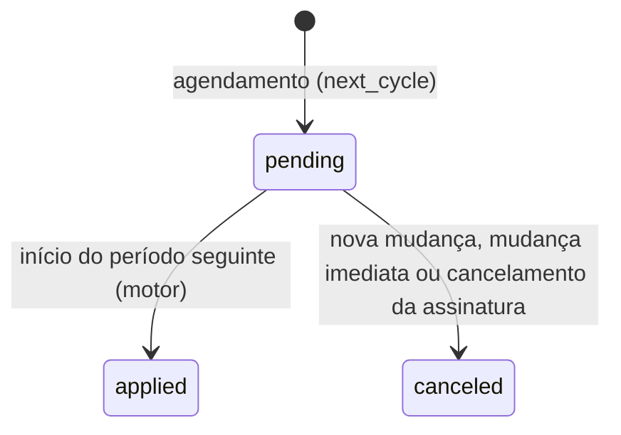
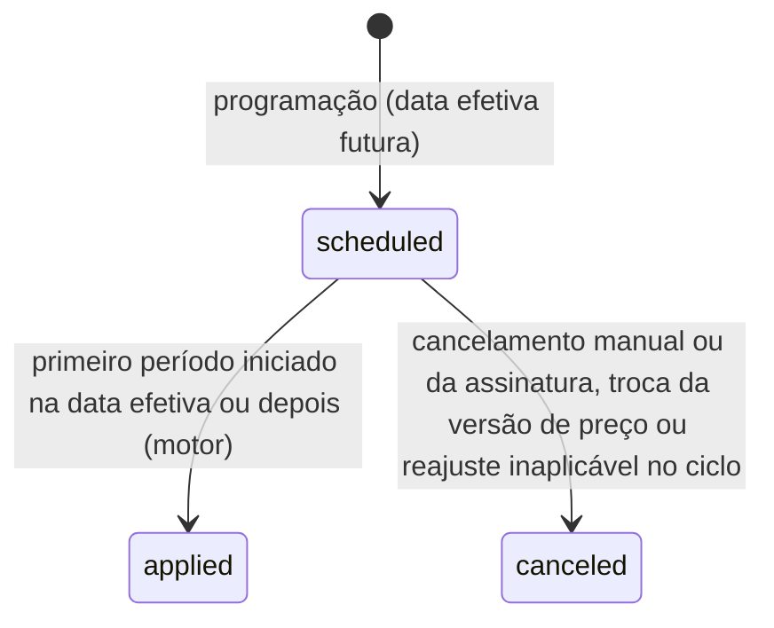
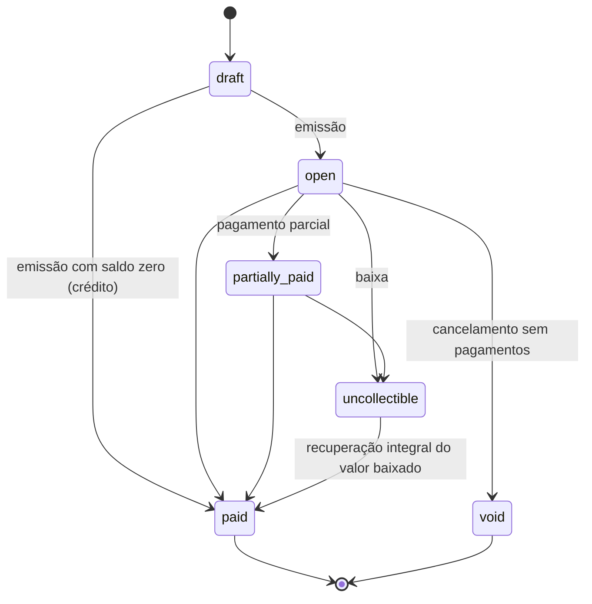
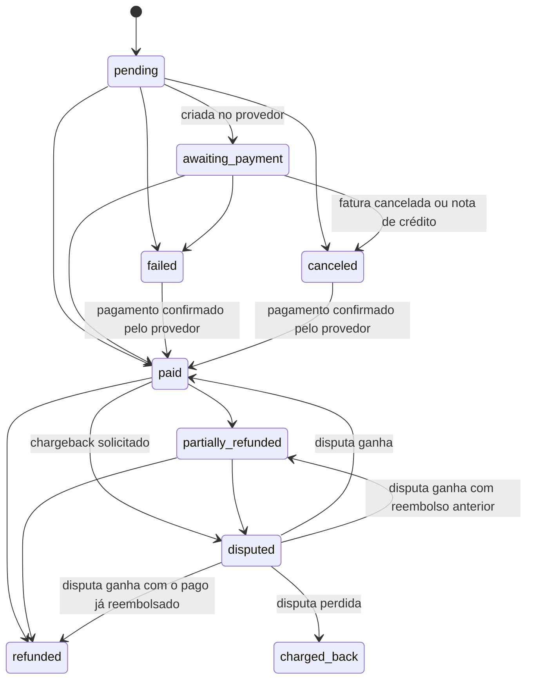
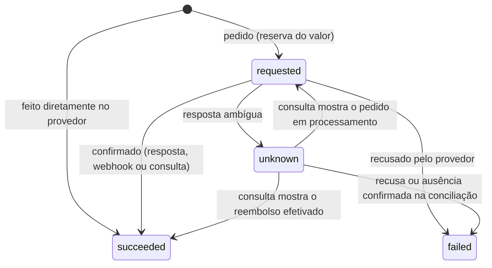
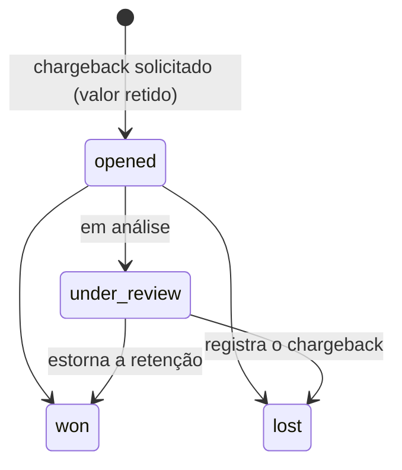
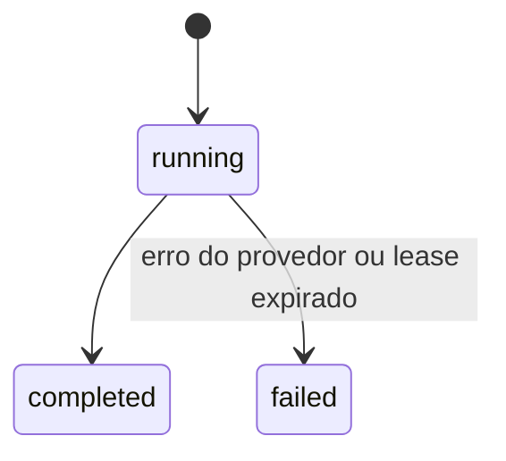
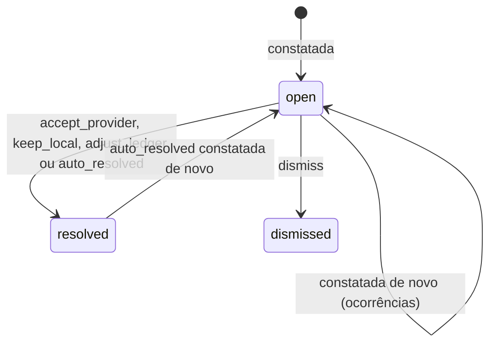
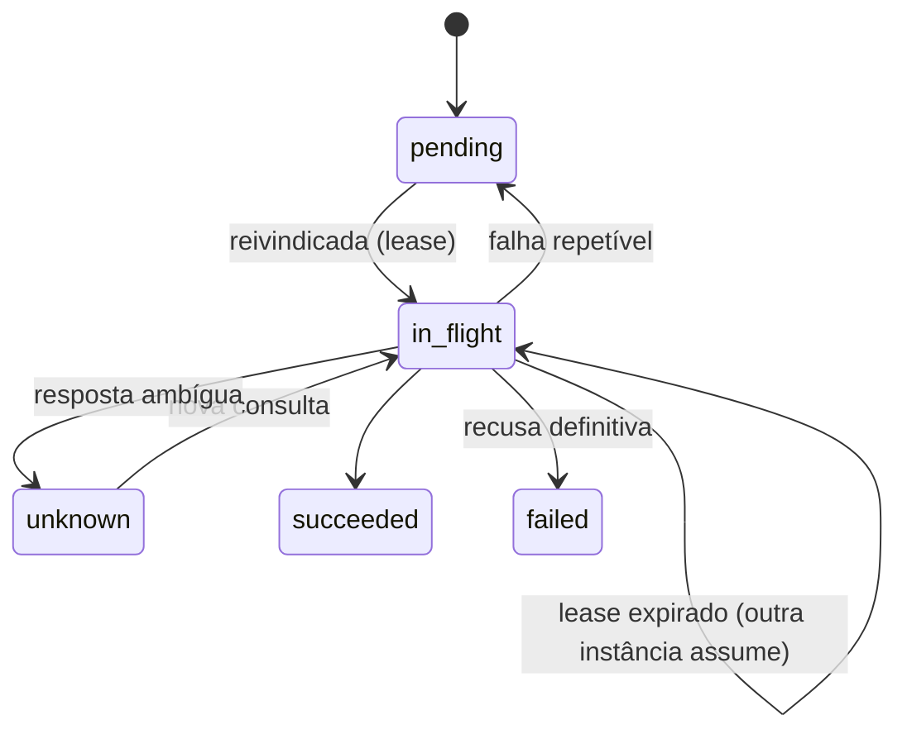

# Máquinas de estado

Transições fora das listadas são rejeitadas com `409 invalid_transition` (assinatura),
`invalid_invoice_transition` (fatura) ou `invalid_charge_transition` (cobrança). Cada transição de
assinatura e de fatura gera uma entrada de histórico imutável.

## Assinatura (`internal/subscriptions`)

Cancelamento ao fim do período é uma marcação (`cancel_at_period_end`) desfeita com
`resume-renewal`; a transição para `canceled` ocorre no motor, no início do período seguinte.
Reativação antes do fim do trial volta a `trialing` e mantém a data original de fim do trial.
Reativação que pula períodos inteiramente suspensos registra em `pending_usage_starts` os períodos
com consumo anterior à suspensão ainda não fechado; o primeiro faturamento após a reativação os
fecha e limpa a lista (ver `dinheiro-e-datas.md`).

## Mudança agendada e reajuste programado (`internal/subscriptions`)

O motivo do cancelamento do reajuste fica em `cancel_reason`: `manual`, `subscription_ended`,
`price_version_changed`, `price_without_fixed_component` ou `adjustment_amount_limit`.

Há no máximo uma mudança `pending` por assinatura e um reajuste `scheduled` por data (índices
únicos parciais).

## Fatura (`internal/billing`)

Fatura emitida não muda número, itens, valores faturados nem snapshot do cliente (gatilho
`app_invoice_guard`). Correções usam nota de crédito, cancelamento com estorno no ledger ou baixa.
Pagamento de fatura incobrável reverte a baixa na mesma medida (lançamento
`invoice.bad_debt_recovered`); enquanto houver valor baixado, a fatura continua `uncollectible`, com
o recebimento registrado no histórico.

## Cobrança (`internal/payments`)

Dinheiro recebido nunca é descartado. A cobrança cancelada no Recorvia é cancelada também no provedor
(operação `cancel_charge`, ADR-037), mas o pagamento pode chegar antes do cancelamento ou o cancelamento
pode falhar; a recusa (por exemplo, do cartão) não impede o pagamento posterior por outro meio no mesmo
checkout. Por isso a confirmação de pagamento pelo provedor é a única transição que sai de `failed` e de
`canceled`: a cobrança passa a `paid` e o valor segue a aplicação normal (quita
o saldo da fatura; o excedente, ou o valor integral quando a fatura já está paga ou cancelada, vira
crédito do cliente; a taxa do provedor é lançada no ledger). A transição incomum é auditada como
`charge.paid_after_failure` ou `charge.paid_after_local_cancellation`, com a situação anterior e,
na recusa, o motivo, que deixa de constar na cobrança paga.

Reembolsos confirmados durante uma disputa ou depois do chargeback somam ao valor reembolsado sem mudar
a situação da cobrança. O saldo reembolsável é o pago menos o reembolsado, o estornado e o reservado por
reembolsos em andamento (`amount_refund_pending`).

## Reembolso (`refunds`)

`failed` libera a reserva; `succeeded` a converte em valor reembolsado. Enquanto houver reembolso
`unknown`, a cobrança não aceita novos pedidos. O reembolso permanece `requested` quando o provedor aceita
o pedido sem efetivá-lo, quando a chamada falha de forma repetível (operação `pending` com backoff) e
quando outro reembolso da mesma cobrança ainda está em execução no provedor (operação adiada). A
resposta de `POST /api/v1/charges/{id}/refunds` traz a situação alcançada na própria requisição.

## Disputa (`disputes`)

Cada transição gera uma entrada imutável em `dispute_events`. Há no máximo uma disputa aberta por
cobrança.

## Conciliação (`reconciliation_runs`, `reconciliation_discrepancies`)

Na API, a divergência resolvida automaticamente aparece com `status = resolved`,
`resolution = auto_resolved` e `resolved_by` nulo. Divergência resolvida manualmente não volta a `open`
com os mesmos valores; valores novos geram outra divergência.

## Operação externa (`payment_operations`)

Depois de `MaxOperationAttempts` tentativas, uma operação `unknown` deixa de ser retomada
automaticamente e exige resolução (reconsulta manual ou conciliação).

Tipos: `create_charge` (criação da cobrança, consulta pela referência externa antes de repetir), `refund`
(reembolso, consulta da cobrança e dos reembolsos antes de repetir; no máximo um reembolso em execução ou
desconhecido por cobrança) e `cancel_charge` (cancelamento no provedor, consulta da cobrança antes de
repetir; um por cobrança).
