# Máquinas de estado

Transições fora das listadas são rejeitadas com `409 invalid_transition` (assinatura),
`invalid_invoice_transition` (fatura) ou `invalid_charge_transition` (cobrança). Cada transição de
assinatura e de fatura gera uma entrada de histórico imutável.

## Assinatura (`internal/subscriptions`)

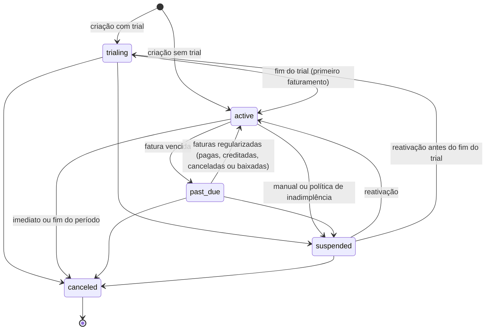

Cancelamento ao fim do período é uma marcação (`cancel_at_period_end`) desfeita com
`resume-renewal`; a transição para `canceled` ocorre no motor, no início do período seguinte.
Reativação antes do fim do trial volta a `trialing` e mantém a data original de fim do trial.
Reativação que pula períodos inteiramente suspensos registra em `pending_usage_starts` os períodos
com consumo anterior à suspensão ainda não fechado; o primeiro faturamento após a reativação os
fecha e limpa a lista (ver `dinheiro-e-datas.md`).

## Mudança agendada e reajuste programado (`internal/subscriptions`)

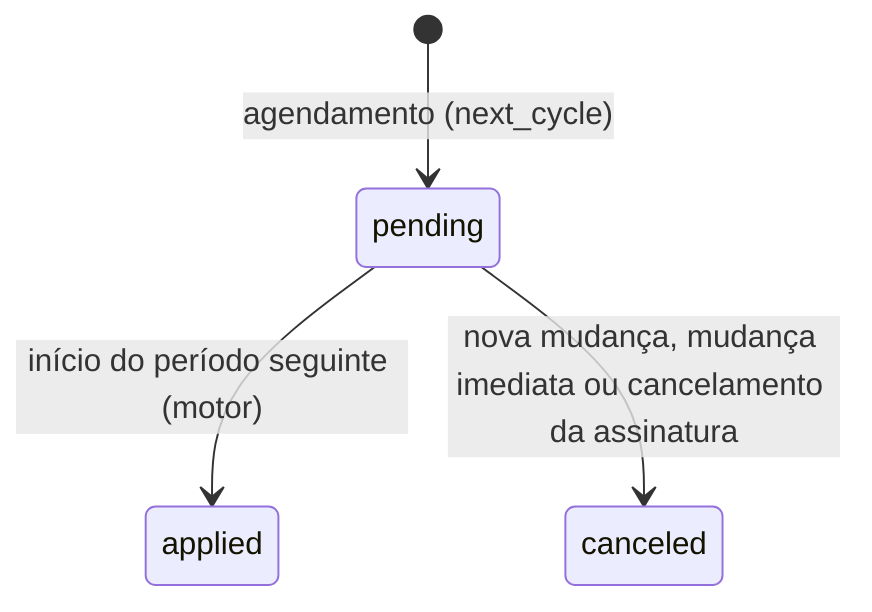

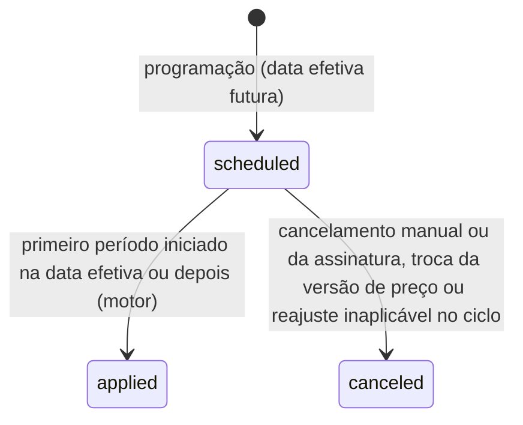

O motivo do cancelamento do reajuste fica em `cancel_reason`: `manual`, `subscription_ended`,
`price_version_changed`, `price_without_fixed_component` ou `adjustment_amount_limit`.

Há no máximo uma mudança `pending` por assinatura e um reajuste `scheduled` por data (índices
únicos parciais).

## Fatura (`internal/billing`)

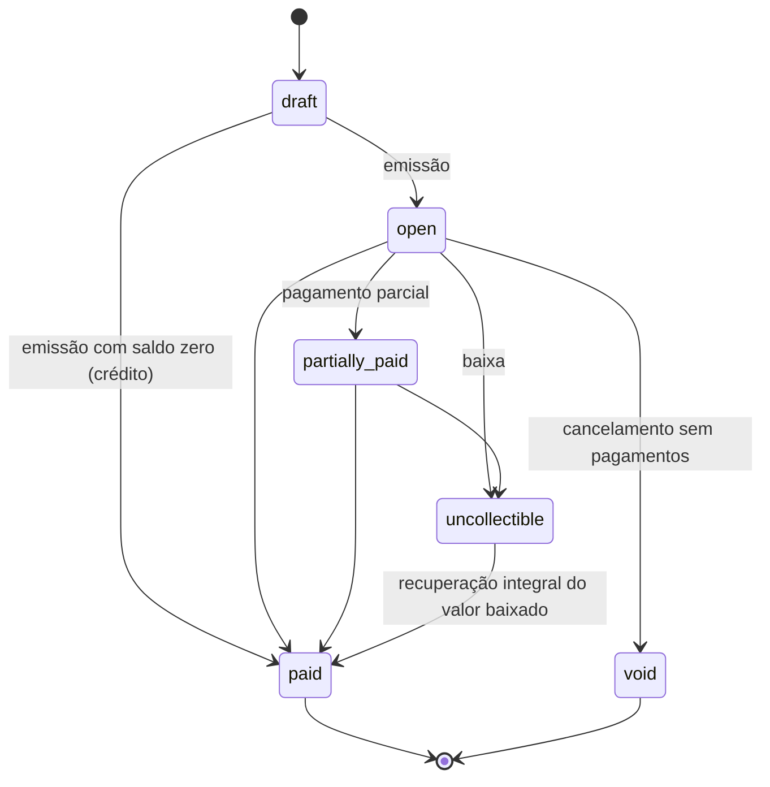

Fatura emitida não muda número, itens, valores faturados nem snapshot do cliente (gatilho
`app_invoice_guard`). Correções usam nota de crédito, cancelamento com estorno no ledger ou baixa.
Pagamento de fatura incobrável reverte a baixa na mesma medida (lançamento
`invoice.bad_debt_recovered`); enquanto houver valor baixado, a fatura continua `uncollectible`, com
o recebimento registrado no histórico.

## Cobrança (`internal/payments`)

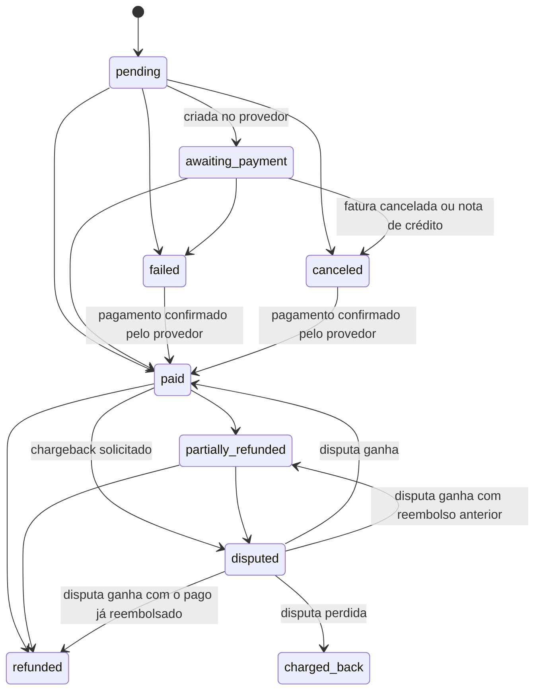

Dinheiro recebido nunca é descartado. A cobrança cancelada no Recorvia é cancelada também no provedor
(operação `cancel_charge`, ADR-037), mas o pagamento pode chegar antes do cancelamento ou o cancelamento
pode falhar; a recusa (por exemplo, do cartão) não impede o pagamento posterior por outro meio no mesmo
checkout. Por isso a confirmação de pagamento pelo provedor é a única transição que sai de `failed` e de
`canceled`: a cobrança passa a `paid` e o valor segue a aplicação normal (quita
o saldo da fatura; o excedente, ou o valor integral quando a fatura já está paga ou cancelada, vira
crédito do cliente; a taxa do provedor é lançada no ledger). A transição incomum é auditada como
`charge.paid_after_failure` ou `charge.paid_after_local_cancellation`, com a situação anterior e,
na recusa, o motivo, que deixa de constar na cobrança paga.

Reembolsos confirmados durante uma disputa ou depois do chargeback somam ao valor reembolsado sem mudar
a situação da cobrança. O saldo reembolsável é o pago menos o reembolsado, o estornado e o reservado por
reembolsos em andamento (`amount_refund_pending`). A disputa perdida estorna no máximo esse saldo: o valor
já reembolsado ou reservado não é estornado de novo, e a confirmação posterior do reembolso reservado
continua cabendo no saldo.

## Reembolso (`refunds`)

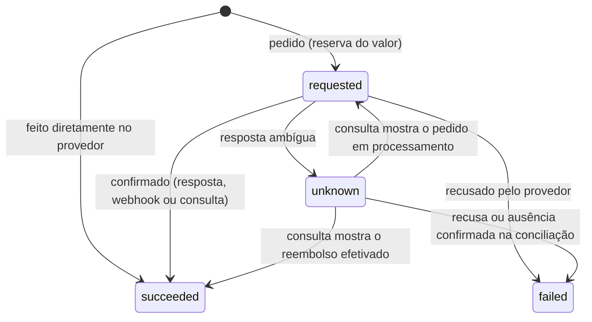

`failed` libera a reserva; `succeeded` a converte em valor reembolsado. Enquanto houver reembolso
`unknown`, a cobrança não aceita novos pedidos. O reembolso permanece `requested` quando o provedor aceita
o pedido sem efetivá-lo, quando a chamada falha de forma repetível (operação `pending` com backoff) e
quando outro reembolso da mesma cobrança ainda está em execução no provedor (operação adiada). Pedido que
ainda não chegou ao provedor quando a cobrança entra em disputa ou é estornada por chargeback passa a
`failed` sem ser enviado (o pagador receberia o valor duas vezes). A resposta de
`POST /api/v1/charges/{id}/refunds` traz a situação alcançada na própria requisição.

## Disputa (`disputes`)

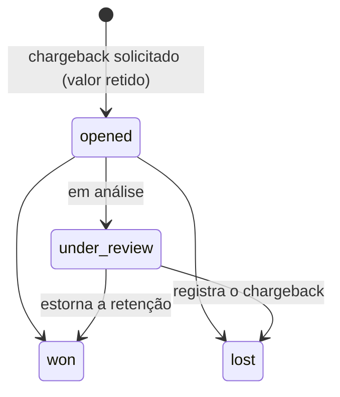

Na disputa perdida, a parte da retenção correspondente ao valor reembolsado (confirmado durante a disputa
ou ainda reservado) volta aos valores em liquidação (`dispute.hold_released`). Reembolso reservado recusado
depois da perda passa ao chargeback (`dispute.hold_restored`).

Quando a cobrança foi paga com excedente convertido em crédito do cliente, a parte do valor estornado que
corresponde ao excedente ainda não devolvido sai de `chargebacks` pelo lançamento `dispute.credit_reversed`
(um pela disputa perdida e um por reembolso recusado depois da perda): o crédito ainda disponível é
consumido (`disputes.credit_amount`) e o que o cliente já usou vira valor a recuperar dele
(`disputes.recovery_amount`, conta `customer_recoverables`), sem deixar o saldo de crédito negativo. Assim,
`chargebacks` registra o valor estornado menos o excedente, isto é, a receita efetivamente perdida
(ADR-070). A disputa ganha não mexe no crédito.

A disputa perdida com valor a recuperar não muda de situação com a baixa (ADR-073): continua `lost`, e o
saldo a recuperar diminui a cada baixa, recebida (`recovery_received_amount`) ou perdida
(`recovery_written_off_amount`), até zero. Baixas parciais são permitidas; a soma nunca passa de
`recovery_amount`. O saldo pode voltar a crescer se um reembolso reservado for recusado depois da perda
(`dispute.chargeback_increased`).

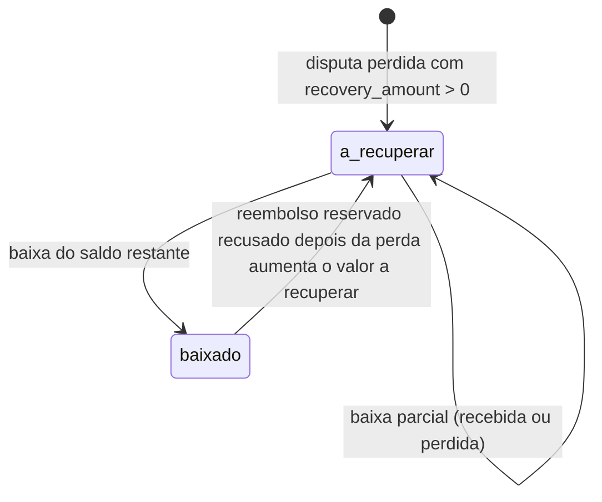

Cada transição gera uma entrada imutável em `dispute_events`. Há no máximo uma disputa aberta por
cobrança.

## Conciliação (`reconciliation_runs`, `reconciliation_discrepancies`)

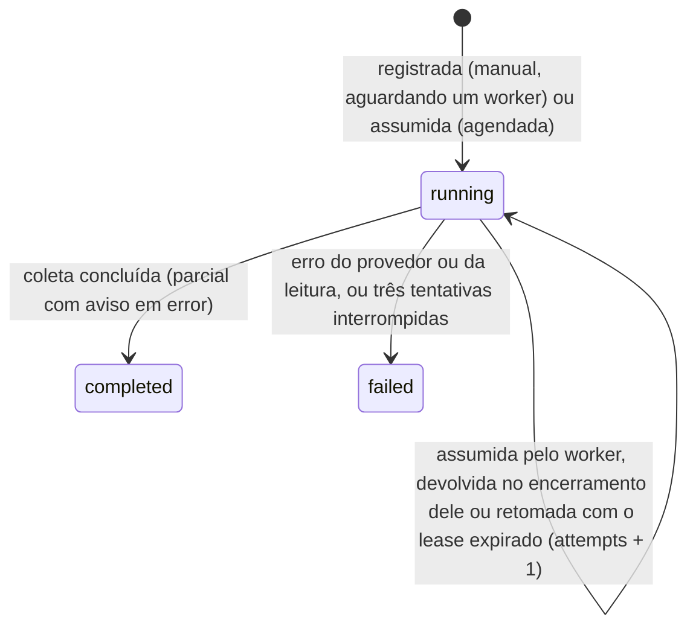

A situação `running` cobre três estados, distinguidos pelo lease: aguardando um worker (`lease_until`
nulo), em execução (lease vigente) e interrompida (lease expirado). O lease expirado não encerra a
execução: ela continua em `running`, a conta do provedor continua ocupada (novos pedidos respondem `409
reconciliation_running`) e qualquer worker a retoma do início. Só ao ser assumida depois de três tentativas
interrompidas ela passa a `failed`, com a causa (ADR-071).

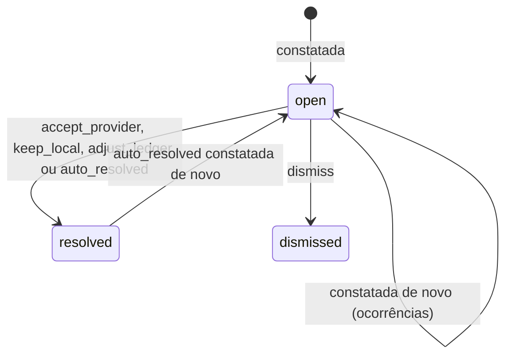

Na API, a divergência resolvida automaticamente aparece com `status = resolved`,
`resolution = auto_resolved` e `resolved_by` nulo. Divergência resolvida manualmente não volta a `open`
com os mesmos valores; valores novos geram outra divergência.

## Operação externa (`payment_operations`)

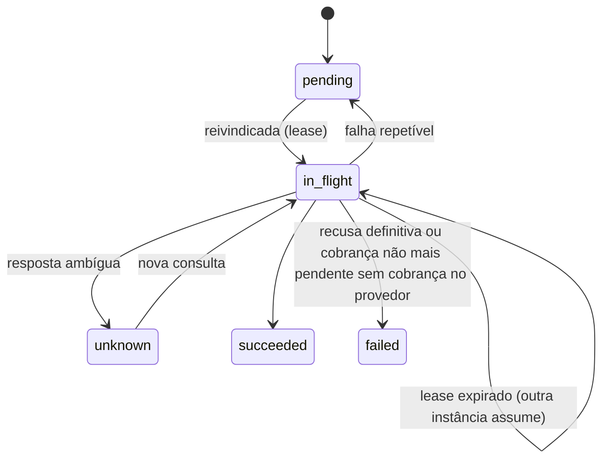

Depois de `MaxOperationAttempts` tentativas, uma operação `unknown` deixa de ser retomada
automaticamente e exige resolução (reconsulta manual ou conciliação).

Tipos: `create_charge` (criação da cobrança, consulta pela referência externa antes de repetir), `refund`
(reembolso, consulta da cobrança e dos reembolsos antes de repetir; no máximo um reembolso em execução ou
desconhecido por cobrança) e `cancel_charge` (cancelamento no provedor, consulta da cobrança antes de
repetir; um por cobrança).

Uma criação cuja cobrança deixou de estar pendente (por exemplo, cancelada com a fatura anulada) é
obsoleta: a execução só consulta o provedor pela referência externa e nunca cria a cobrança. Encontrada
a cobrança (criada por uma tentativa anterior), ela é vinculada sem `charge.created` e cancelada também
no provedor por uma operação `cancel_charge`; um pagamento que chegue por ela antes do cancelamento vira
crédito do cliente. Sem cobrança no provedor, a operação termina em `failed`. Uma criação `pending`
obsoleta não conta como esgotada.

## Notificação (`internal/notifications`)

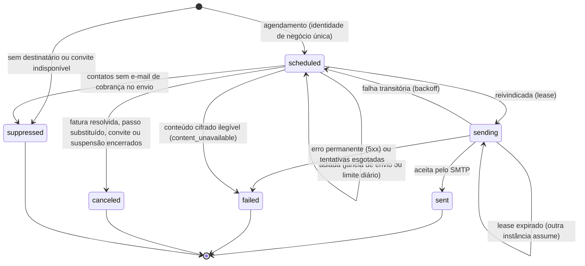

O motivo fica em `status_reason` e cada mudança gera uma entrada em `notification_events`.

## Suspensão pela política (`internal/collections`)

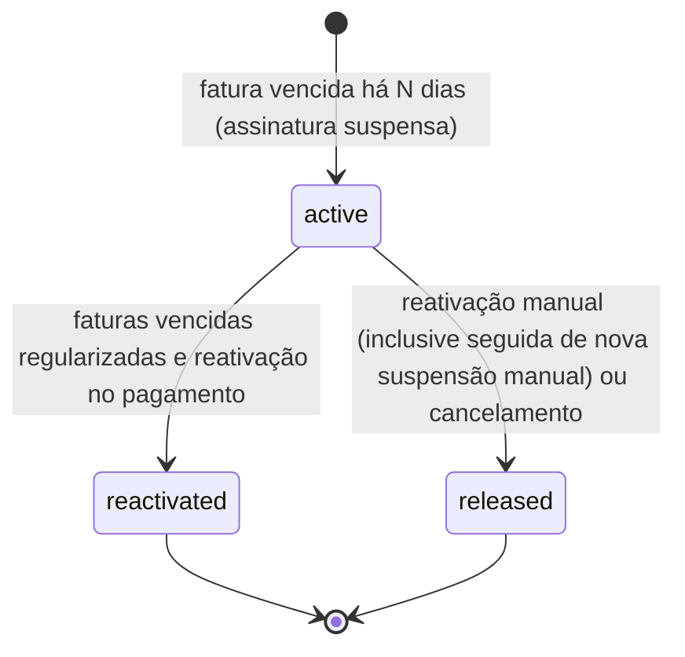

## Entrega de webhook (`internal/webhooks`)

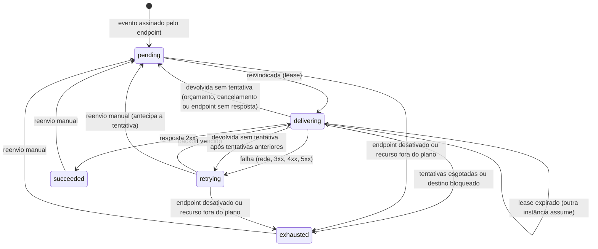

O reenvio manual (`POST /api/v1/webhook-deliveries/{id}/retry`) é recusado com `409` enquanto a
entrega está `pending` ou `delivering`, quando o endpoint está desativado ou removido e quando a
entrega já soma 100 tentativas (`delivery_attempts_limit`); para entregas concluídas, concede uma
tentativa além das já feitas.

## Endpoint de webhook (`internal/webhooks`)

```mermaid
stateDiagram-v2
  [*] --> active: criação (destino validado, primeiro segredo)
  active --> disabled: alteração (status disabled; permitida sem o recurso no plano)
  disabled --> active: alteração (destino revalidado; exige o recurso no plano)
  active --> removido: DELETE
  disabled --> removido: DELETE
  removido --> [*]
```

A remoção grava `deleted_at` e `status = disabled`: o endpoint sai da listagem, as operações sobre
ele respondem `404` e as entregas pendentes terminam como `exhausted` na próxima execução do job.
A rotação de segredo não muda a situação nem a versão do endpoint.

## Inadimplência da fatura (`internal/collections`)

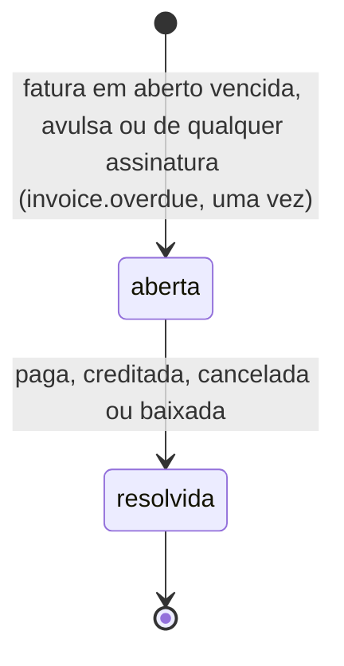

O registro em `invoice_delinquencies` é único por fatura; a resolução (`paid`, `credited`, `void`,
`uncollectible`) é gravada pelo consumidor da fatura resolvida e conferida a cada execução da
régua.
