# Máquinas de estado

Transições fora das listadas são rejeitadas com `409 invalid_transition` (assinatura),
`invalid_invoice_transition` (fatura) ou `invalid_charge_transition` (cobrança). Cada transição de
assinatura e de fatura gera uma entrada de histórico imutável.

## Assinatura (`internal/subscriptions`)

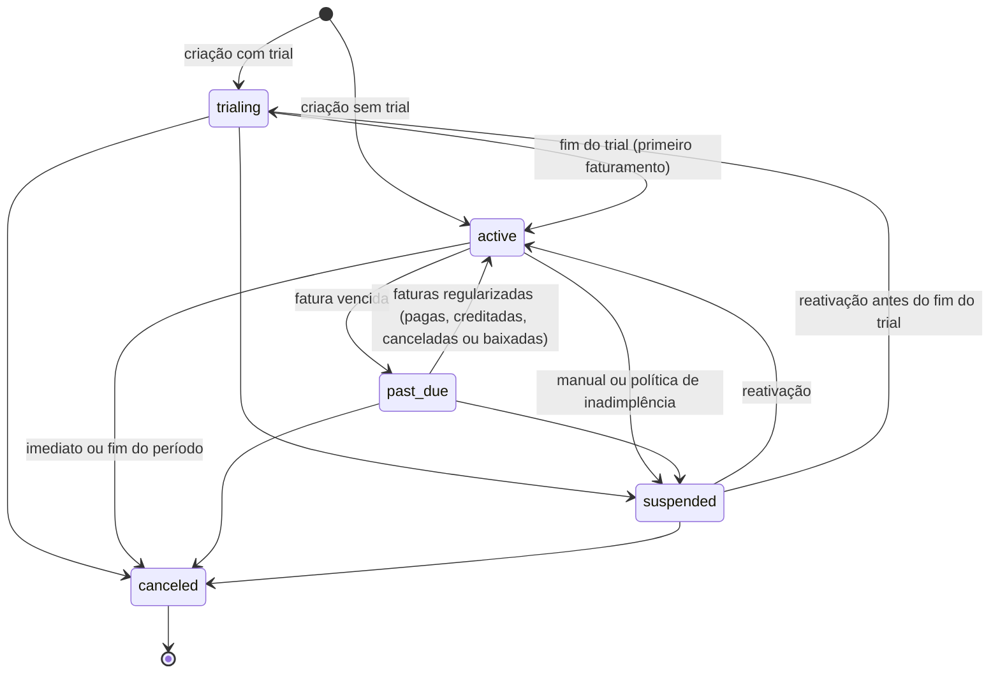

Cancelamento ao fim do período é uma marcação (`cancel_at_period_end`) desfeita com
`resume-renewal`; a transição para `canceled` ocorre no motor, no início do período seguinte.
Reativação antes do fim do trial volta a `trialing` e mantém a data original de fim do trial.
Reativação que pula períodos inteiramente suspensos registra em `pending_usage_starts` os períodos
com consumo anterior à suspensão ainda não fechado; o primeiro faturamento após a reativação os
fecha e limpa a lista (ver `dinheiro-e-datas.md`).

## Mudança agendada e reajuste programado (`internal/subscriptions`)

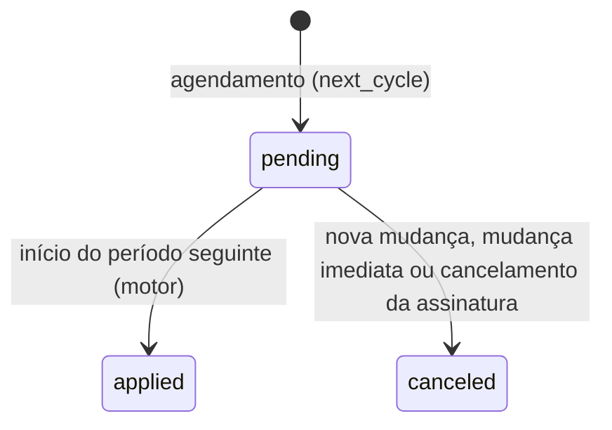

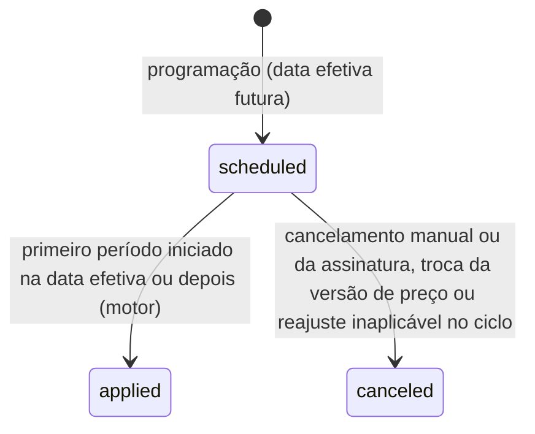

O motivo do cancelamento do reajuste fica em `cancel_reason`: `manual`, `subscription_ended`,
`price_version_changed`, `price_without_fixed_component` ou `adjustment_amount_limit`.

Há no máximo uma mudança `pending` por assinatura e um reajuste `scheduled` por data (índices
únicos parciais).

## Fatura (`internal/billing`)

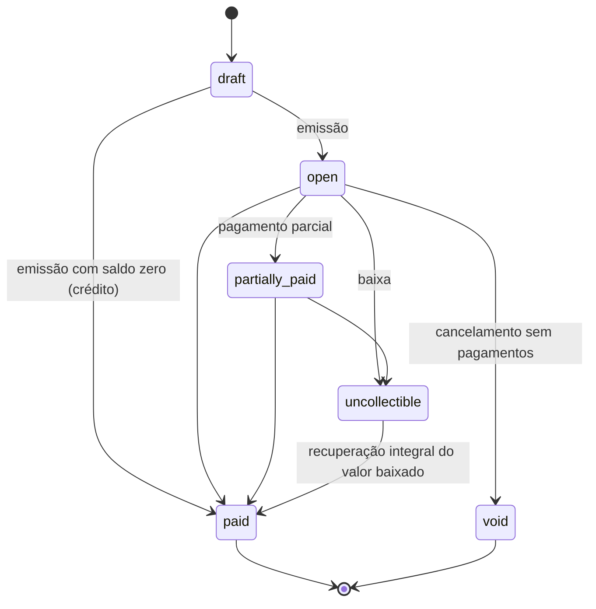

Fatura emitida não muda número, itens, valores faturados nem snapshot do cliente (gatilho
`app_invoice_guard`). Correções usam nota de crédito, cancelamento com estorno no ledger ou baixa.
Pagamento de fatura incobrável reverte a baixa na mesma medida (lançamento
`invoice.bad_debt_recovered`); enquanto houver valor baixado, a fatura continua `uncollectible`, com
o recebimento registrado no histórico.

## Cobrança (`internal/payments`)

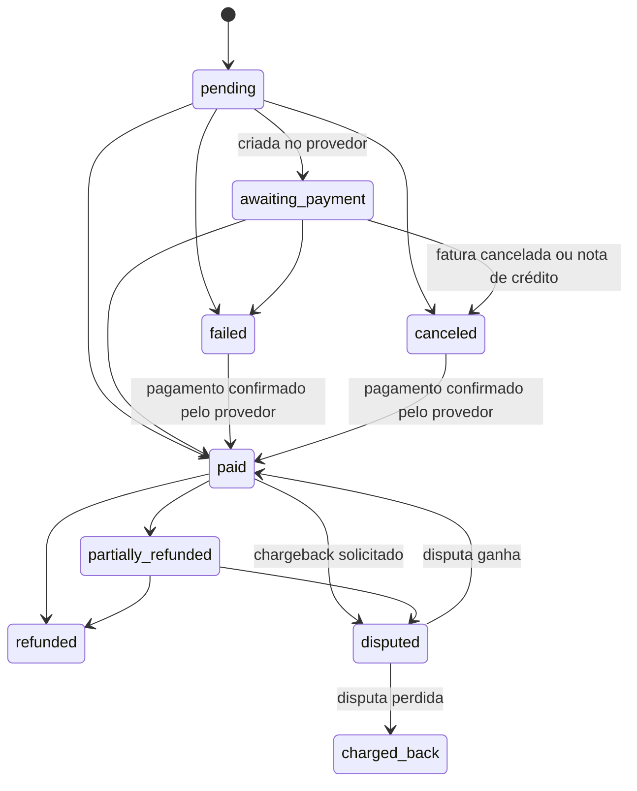

Dinheiro recebido nunca é descartado. O cancelamento de cobrança é apenas local (a cobrança continua
válida no provedor), e a recusa (por exemplo, do cartão) não impede o pagamento posterior por outro
meio no mesmo checkout. Por isso a confirmação de pagamento pelo provedor é a única transição que
sai de `failed` e de `canceled`: a cobrança passa a `paid` e o valor segue a aplicação normal (quita
o saldo da fatura; o excedente, ou o valor integral quando a fatura já está paga ou cancelada, vira
crédito do cliente; a taxa do provedor é lançada no ledger). A transição incomum é auditada como
`charge.paid_after_failure` ou `charge.paid_after_local_cancellation`, com a situação anterior e,
na recusa, o motivo, que deixa de constar na cobrança paga.

## Operação externa (`payment_operations`)

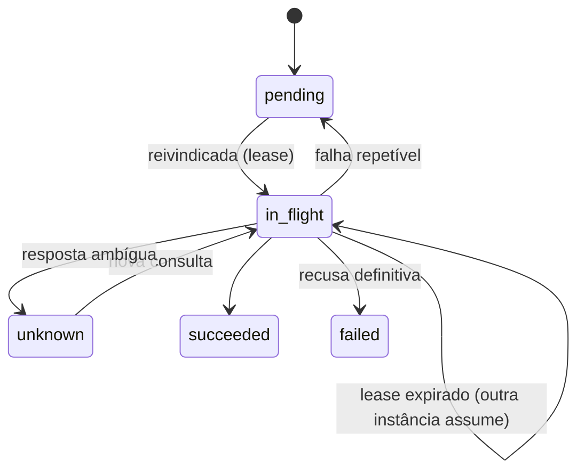

Depois de `MaxOperationAttempts` tentativas, uma operação `unknown` deixa de ser retomada
automaticamente e exige resolução (reconsulta manual ou conciliação).

## Notificação (`internal/notifications`)

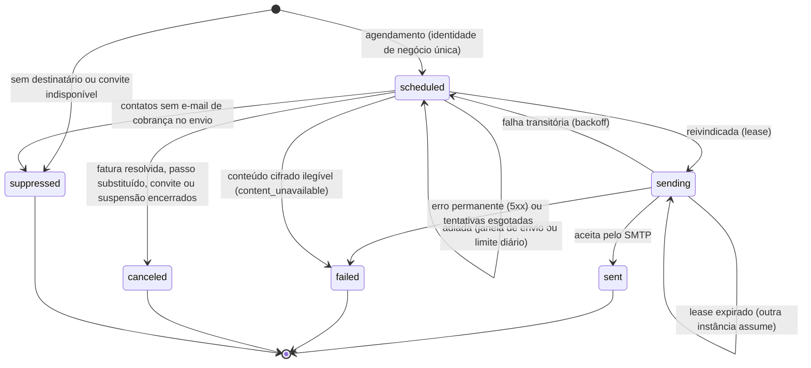

O motivo fica em `status_reason` e cada mudança gera uma entrada em `notification_events`.

## Suspensão pela política (`internal/collections`)

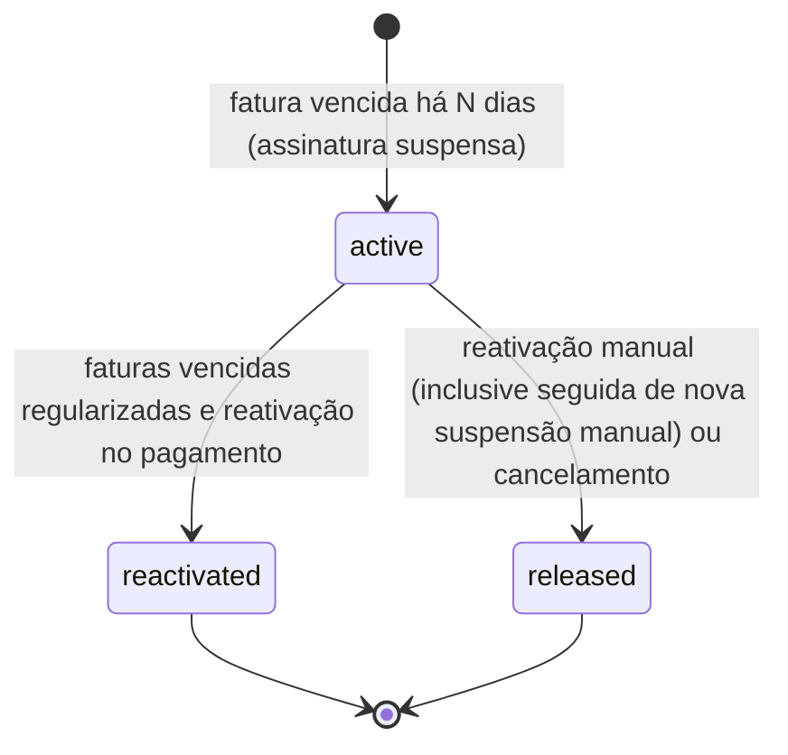

## Entrega de webhook (`internal/webhooks`)

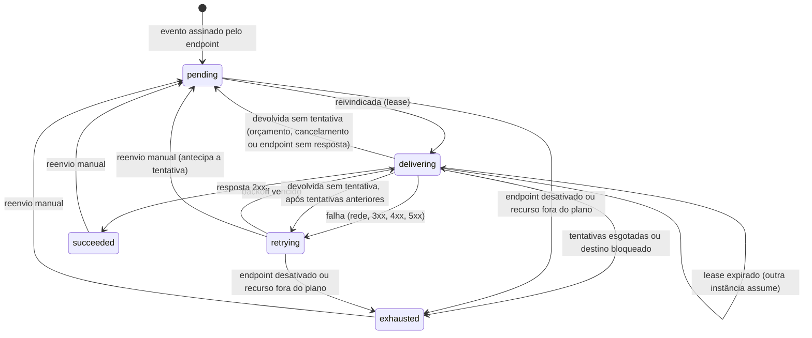

O reenvio manual (`POST /api/v1/webhook-deliveries/{id}/retry`) é recusado com `409` enquanto a
entrega está `pending` ou `delivering`, quando o endpoint está desativado ou removido e quando a
entrega já soma 100 tentativas (`delivery_attempts_limit`); para entregas concluídas, concede uma
tentativa além das já feitas.

## Endpoint de webhook (`internal/webhooks`)

```mermaid
stateDiagram-v2
  [*] --> active: criação (destino validado, primeiro segredo)
  active --> disabled: alteração (status disabled; permitida sem o recurso no plano)
  disabled --> active: alteração (destino revalidado; exige o recurso no plano)
  active --> removido: DELETE
  disabled --> removido: DELETE
  removido --> [*]
```

A remoção grava `deleted_at` e `status = disabled`: o endpoint sai da listagem, as operações sobre
ele respondem `404` e as entregas pendentes terminam como `exhausted` na próxima execução do job.
A rotação de segredo não muda a situação nem a versão do endpoint.

## Inadimplência da fatura (`internal/collections`)

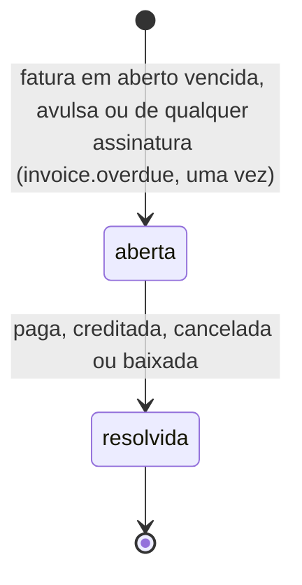

O registro em `invoice_delinquencies` é único por fatura; a resolução (`paid`, `credited`, `void`,
`uncollectible`) é gravada pelo consumidor da fatura resolvida e conferida a cada execução da
régua.
