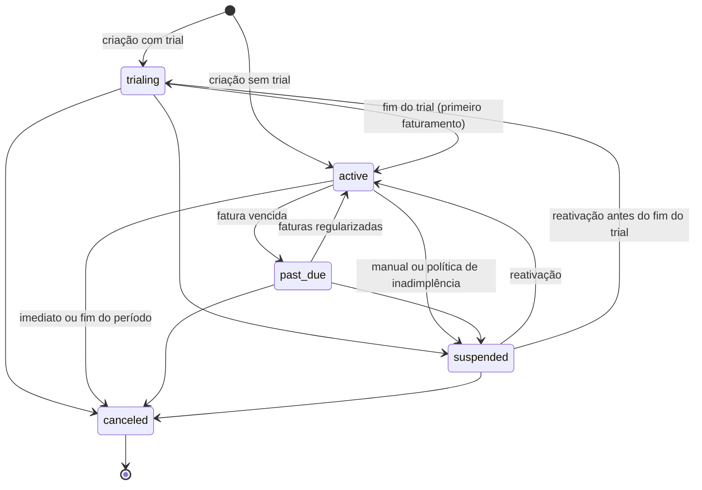
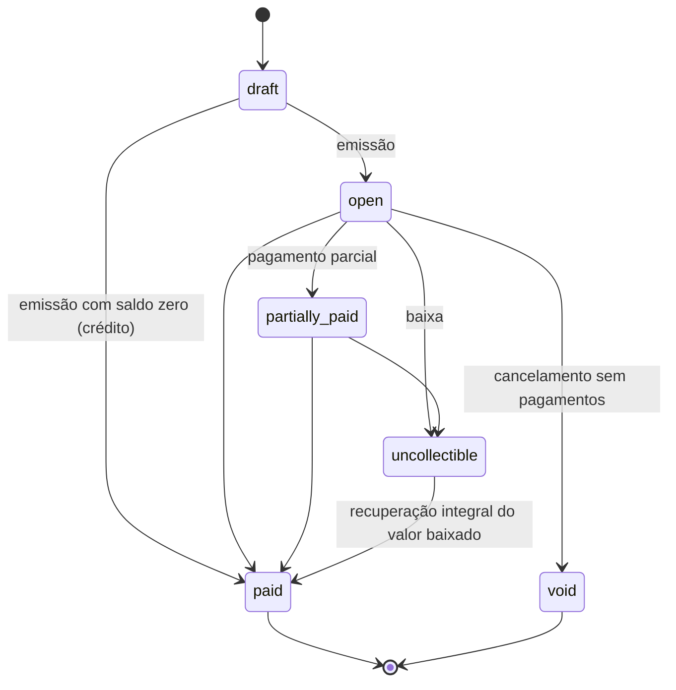
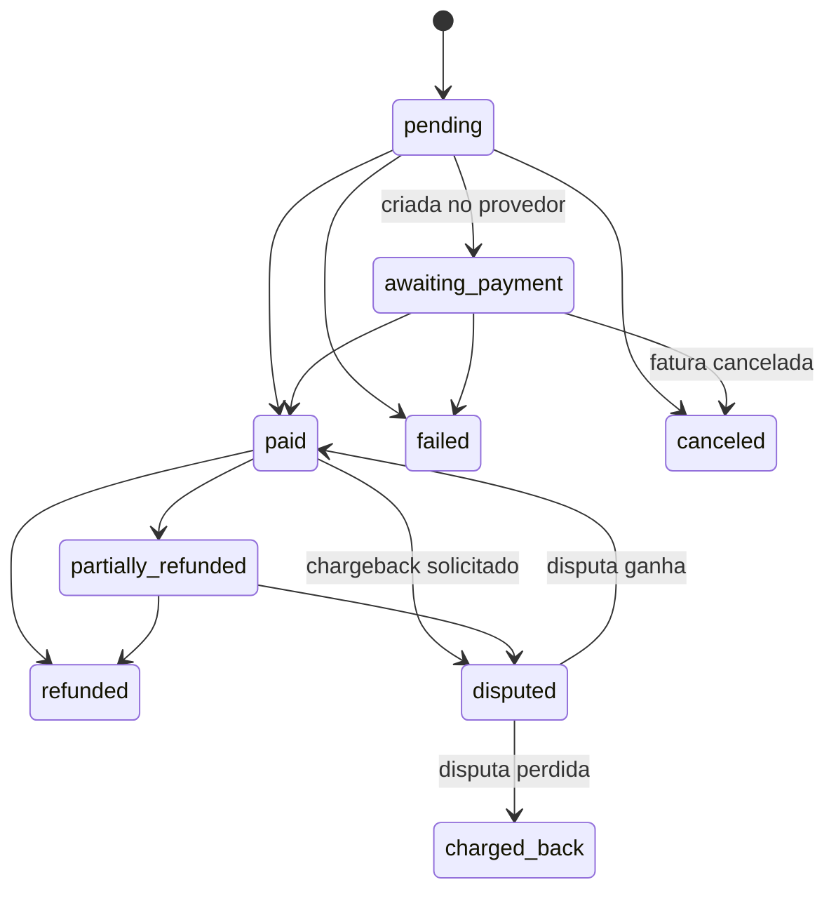
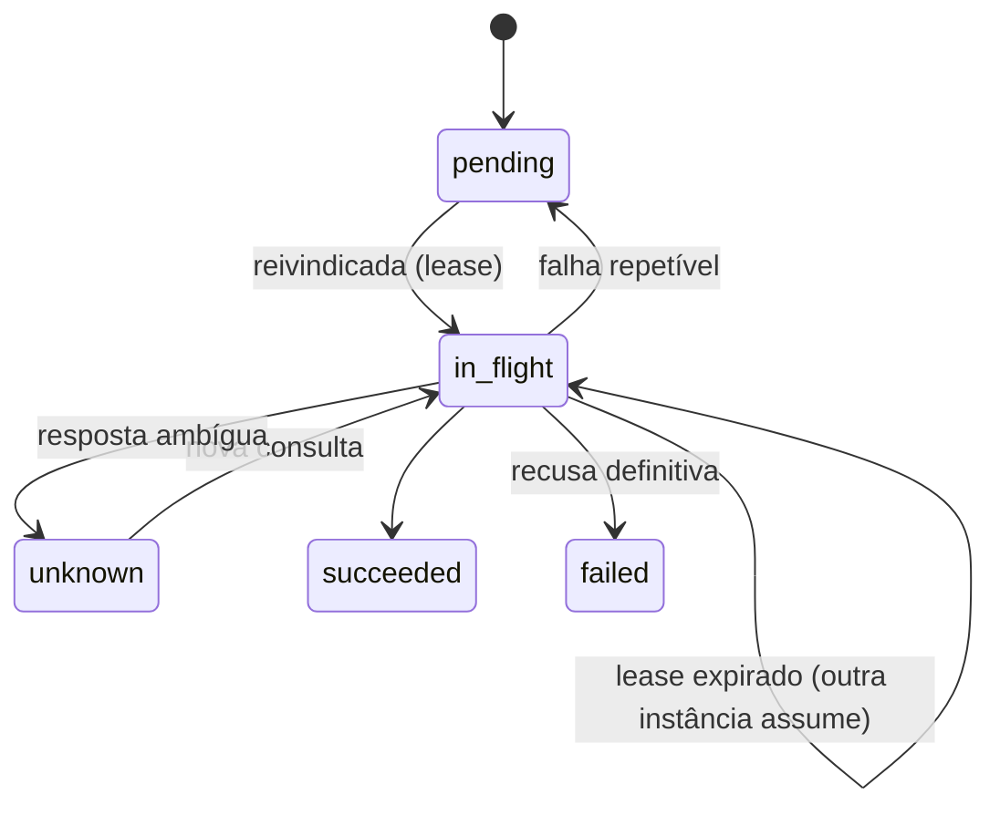

# Máquinas de estado

Transições fora das listadas são rejeitadas com `409 invalid_transition` (assinatura),
`invalid_invoice_transition` (fatura) ou `invalid_charge_transition` (cobrança). Cada transição de
assinatura e de fatura gera uma entrada de histórico imutável.

## Assinatura (`internal/subscriptions`)

Cancelamento ao fim do período é uma marcação (`cancel_at_period_end`) desfeita com
`resume-renewal`; a transição para `canceled` ocorre no motor, no início do período seguinte.
Reativação antes do fim do trial volta a `trialing` e mantém a data original de fim do trial.

## Fatura (`internal/billing`)

Fatura emitida não muda número, itens, valores faturados nem snapshot do cliente (gatilho
`app_invoice_guard`). Correções usam nota de crédito, cancelamento com estorno no ledger ou baixa.
Pagamento de fatura incobrável reverte a baixa na mesma medida (lançamento
`invoice.bad_debt_recovered`); enquanto houver valor baixado, a fatura continua `uncollectible`, com
o recebimento registrado no histórico.

## Cobrança (`internal/payments`)

## Operação externa (`payment_operations`)

Depois de `MaxOperationAttempts` tentativas, uma operação `unknown` deixa de ser retomada
automaticamente e exige resolução (reconsulta manual ou conciliação).
