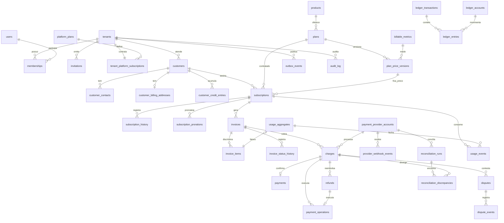

# Modelo de dados

O schema completo está em `db/migrations` (Goose). Todas as tabelas de tenant têm `tenant_id`,
`UNIQUE (tenant_id, id)`, FKs compostas e RLS (ver `multitenancy.md`).

## Tabelas por módulo

| Módulo | Tabelas |
|---|---|
| Organizações e identidade | `tenants`, `users`, `memberships`, `invitations`, `platform_staff` |
| Plataforma | `platform_plans`, `platform_addons`, `tenant_platform_subscriptions`, `platform_addon_orders`, `platform_statements` |
| Clientes | `customers`, `customer_contacts`, `customer_billing_addresses`, `customer_provider_refs`, `customer_credit_entries` |
| Catálogo | `products`, `billable_metrics`, `plans`, `plan_price_versions`, `coupons` |
| Assinaturas | `subscriptions`, `subscription_history`, `subscription_discounts`, `pending_invoice_items`, `subscription_scheduled_changes`, `subscription_price_adjustments`, `subscription_prorations` |
| Consumo | `usage_events`, `usage_aggregates` |
| Faturamento | `invoice_number_sequences`, `invoices`, `invoice_items`, `invoice_status_history`, `credit_notes` |
| Pagamentos | `payment_provider_accounts`, `charges`, `payment_operations`, `payments`, `provider_webhook_events` |
| Recebíveis | `refunds`, `disputes`, `dispute_events`, `reconciliation_runs`, `reconciliation_discrepancies` |
| Ledger | `ledger_accounts`, `ledger_transactions`, `ledger_entries` |
| Infraestrutura | `outbox_events`, `inbox_messages`, `dead_letters`, `idempotency_keys`, `scheduled_jobs`, `audit_log` |

## Recebíveis

| Tabela ou coluna | Conteúdo |
|---|---|
| `charges.amount_refund_pending` | valor reservado por reembolsos ainda não confirmados; a confirmação o move para `amount_refunded` e a recusa o libera. O saldo reembolsável é `amount_paid - amount_refunded - amount_charged_back - amount_refund_pending` |
| `refunds` | reembolso total ou parcial (`requested`, `succeeded`, `failed`, `unknown`); `origin` distingue pedido do Recorvia (`recorvia`, com `request_key` e `requested_by`) de reembolso feito no provedor (`provider`); `credit_amount` é a parte que devolveu crédito do cliente gerado pelo excedente do próprio pagamento; `provider_refund_id` é único por cobrança |
| `payment_operations` (`kind = 'refund'`, `'cancel_charge'`) | chamada externa do reembolso (vinculada por `refund_id`, referência externa = ID do reembolso) e do cancelamento no provedor (uma por cobrança) |
| `disputes`, `dispute_events` | disputa por cobrança (`opened`, `under_review`, `won`, `lost`) com o valor contestado e o histórico imutável de transições com a situação informada pelo provedor |
| `reconciliation_runs` | execução manual ou agendada (`trigger_type`) sobre a janela `[window_start, window_end)` da conta do provedor, com `lease_until` para encerrar execuções interrompidas e `request_key` derivada do `Idempotency-Key` |
| `reconciliation_discrepancies` | divergência deduplicada por `dedupe_key` (tipo, objeto e valores) com primeira e última execução, ocorrências, valores inteiros usados na resolução (`local_amount`, `provider_amount`), retratos exibidos (`local_value`, `provider_value`), resolução, justificativa, responsável e lançamento de ajuste |

Funções `SECURITY DEFINER` da etapa: `app_tenants_due_reconciliation` (tenants elegíveis à conciliação
agendada, somente IDs), `app_open_discrepancy_stats` e `app_refund_stats` (contagens agregadas para
métricas, sem identificar tenants). A reivindicação de operações de reembolso usa um bloqueio consultivo
transacional por cobrança (`pg_advisory_xact_lock`), sem bloquear a linha da cobrança.

## Invariantes no banco

| Invariante | Mecanismo |
|---|---|
| Fatura única por assinatura e período | índice único parcial `invoices_subscription_period_key` |
| Numeração única por tenant | `UNIQUE (tenant_id, number)` + sequência bloqueada |
| Evento de consumo único | `UNIQUE (tenant_id, external_id)` |
| Webhook único por provedor | `UNIQUE (tenant_id, provider, provider_event_id)` |
| Cobrança do provedor vinculada uma vez | `UNIQUE (tenant_id, provider, provider_charge_id)` |
| Um pagamento por cobrança; pedido manual único | `payments_charge_key`, `payments_request_key` |
| Reembolso nunca maior que o pago | `charges_refund_limit` (reembolsado + estornado) e `charges_refund_reservation_limit` (reembolsado + reservado) |
| Pedido de reembolso único; reembolso do provedor registrado uma vez | `refunds_request_key`, `refunds_provider_refund_key` |
| Operação de reembolso vinculada ao reembolso; um cancelamento no provedor por cobrança | `payment_operations_refund_link`, `payment_operations_refund_fk`, `payment_operations_cancel_key` |
| Uma disputa aberta por cobrança; histórico imutável | `disputes_open_key`, `app_reject_mutation` em `dispute_events` |
| Uma conciliação em andamento por conta; divergência única por chave | `reconciliation_runs_running_key`, `reconciliation_discrepancies_dedupe_key` |
| Divergência resolvida com justificativa; descartada somente por `dismiss` | `reconciliation_discrepancies_resolution`, `reconciliation_discrepancies_dismissed` |
| Reembolso, disputa e execução concluídos com data | `refunds_completion`, `disputes_closed`, `reconciliation_runs_finished` |
| Reembolso do provedor sem pedido nem solicitante | `refunds_origin_request` |
| Ledger balanceado e imutável | gatilho de restrição adiado + `app_reject_mutation` |
| Fatura emitida não reescrita | gatilho `app_invoice_guard` |
| Versão de preço imutável | `app_reject_mutation` |
| Nota de crédito imutável, número única por tenant e pedido único | `app_reject_mutation`, `credit_notes_number_key`, `credit_notes_request_key` |
| Uma mudança pendente por assinatura; um reajuste programado por data | `subscription_scheduled_changes_pending_key`, `subscription_price_adjustments_date_key` |
| Item pendente sempre positivo (créditos viram crédito do cliente) | `pending_invoice_items_positive` |
| Valor reajustado sempre ligado ao reajuste que o originou | `subscriptions_override_consistency` |
| Prorrata registrada imutável, dentro do período de cobrança | `app_reject_mutation`, `subscription_prorations_period` |
| Valores na escala do preço unitário comportam `money.MaxAmount` | colunas `numeric(28,10)` (`unit_amount`, reajustes, bases de prorrata) |
| Total da fatura coerente | `total = subtotal - desconto`; `saldo = total - crédito - pago - creditado - baixado` |
