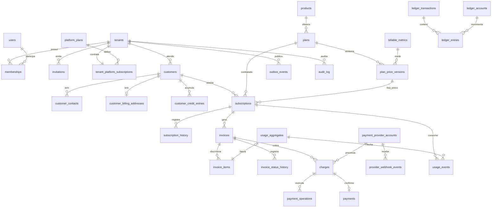

# Modelo de dados

O schema completo está em `db/migrations` (Goose). Todas as tabelas de tenant têm `tenant_id`,
`UNIQUE (tenant_id, id)`, FKs compostas e RLS (ver `multitenancy.md`).

## Tabelas por módulo

| Módulo | Tabelas |
|---|---|
| Organizações e identidade | `tenants`, `users`, `memberships`, `invitations`, `platform_staff` |
| Plataforma | `platform_plans`, `platform_addons`, `tenant_platform_subscriptions`, `platform_addon_orders`, `platform_statements` |
| Clientes | `customers`, `customer_contacts`, `customer_billing_addresses`, `customer_provider_refs`, `customer_credit_entries` |
| Catálogo | `products`, `billable_metrics`, `plans`, `plan_price_versions`, `coupons` |
| Assinaturas | `subscriptions`, `subscription_history`, `subscription_discounts`, `pending_invoice_items` |
| Consumo | `usage_events`, `usage_aggregates` |
| Faturamento | `invoice_number_sequences`, `invoices`, `invoice_items`, `invoice_status_history` |
| Pagamentos | `payment_provider_accounts`, `charges`, `payment_operations`, `payments`, `provider_webhook_events` |
| Ledger | `ledger_accounts`, `ledger_transactions`, `ledger_entries` |
| Infraestrutura | `outbox_events`, `inbox_messages`, `dead_letters`, `idempotency_keys`, `scheduled_jobs`, `audit_log` |

## Invariantes no banco

| Invariante | Mecanismo |
|---|---|
| Fatura única por assinatura e período | índice único parcial `invoices_subscription_period_key` |
| Numeração única por tenant | `UNIQUE (tenant_id, number)` + sequência bloqueada |
| Evento de consumo único | `UNIQUE (tenant_id, external_id)` |
| Webhook único por provedor | `UNIQUE (tenant_id, provider, provider_event_id)` |
| Cobrança do provedor vinculada uma vez | `UNIQUE (tenant_id, provider, provider_charge_id)` |
| Um pagamento por cobrança; pedido manual único | `payments_charge_key`, `payments_request_key` |
| Reembolso nunca maior que o pago | `charges_refund_limit` |
| Ledger balanceado e imutável | gatilho de restrição adiado + `app_reject_mutation` |
| Fatura emitida não reescrita | gatilho `app_invoice_guard` |
| Versão de preço imutável | `app_reject_mutation` |
| Total da fatura coerente | `total = subtotal - desconto`; `saldo = total - crédito - pago - creditado - baixado` |
