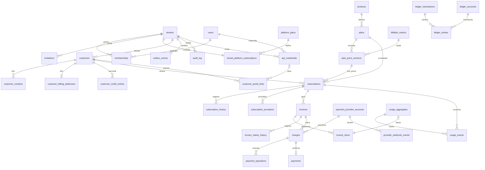

# Modelo de dados

O schema completo está em `db/migrations` (Goose). Todas as tabelas de tenant têm `tenant_id`,
`UNIQUE (tenant_id, id)`, FKs compostas e RLS (ver `multitenancy.md`).

## Tabelas por módulo

| Módulo | Tabelas |
|---|---|
| Organizações e identidade | `tenants`, `users`, `memberships`, `invitations`, `platform_staff`, `api_credentials` |
| Plataforma | `platform_plans`, `platform_addons`, `tenant_platform_subscriptions`, `platform_addon_orders`, `platform_statements` |
| Clientes | `customers`, `customer_contacts`, `customer_billing_addresses`, `customer_provider_refs`, `customer_credit_entries`, `customer_portal_links` |
| Catálogo | `products`, `billable_metrics`, `plans`, `plan_price_versions`, `coupons` |
| Assinaturas | `subscriptions`, `subscription_history`, `subscription_discounts`, `pending_invoice_items`, `subscription_scheduled_changes`, `subscription_price_adjustments`, `subscription_prorations` |
| Consumo | `usage_events`, `usage_aggregates` |
| Faturamento | `invoice_number_sequences`, `invoices`, `invoice_items`, `invoice_status_history`, `credit_notes` |
| Pagamentos | `payment_provider_accounts`, `charges`, `payment_operations`, `payments`, `provider_webhook_events` |
| Ledger | `ledger_accounts`, `ledger_transactions`, `ledger_entries` |
| Infraestrutura | `outbox_events`, `inbox_messages`, `dead_letters`, `idempotency_keys`, `scheduled_jobs`, `audit_log` |

## Invariantes no banco

| Invariante | Mecanismo |
|---|---|
| Fatura única por assinatura e período | índice único parcial `invoices_subscription_period_key` |
| Numeração única por tenant | `UNIQUE (tenant_id, number)` + sequência bloqueada |
| Evento de consumo único | `UNIQUE (tenant_id, external_id)` |
| Webhook único por provedor | `UNIQUE (tenant_id, provider, provider_event_id)` |
| Cobrança do provedor vinculada uma vez | `UNIQUE (tenant_id, provider, provider_charge_id)` |
| Um pagamento por cobrança; pedido manual único | `payments_charge_key`, `payments_request_key` |
| Reembolso nunca maior que o pago | `charges_refund_limit` |
| Ledger balanceado e imutável | gatilho de restrição adiado + `app_reject_mutation` |
| Fatura emitida não reescrita | gatilho `app_invoice_guard` |
| Versão de preço imutável | `app_reject_mutation` |
| Nota de crédito imutável, número única por tenant e pedido único | `app_reject_mutation`, `credit_notes_number_key`, `credit_notes_request_key` |
| Uma mudança pendente por assinatura; um reajuste programado por data | `subscription_scheduled_changes_pending_key`, `subscription_price_adjustments_date_key` |
| Item pendente sempre positivo (créditos viram crédito do cliente) | `pending_invoice_items_positive` |
| Valor reajustado sempre ligado ao reajuste que o originou | `subscriptions_override_consistency` |
| Prorrata registrada imutável, dentro do período de cobrança | `app_reject_mutation`, `subscription_prorations_period` |
| Valores na escala do preço unitário comportam `money.MaxAmount` | colunas `numeric(28,10)` (`unit_amount`, reajustes, bases de prorrata) |
| Total da fatura coerente | `total = subtotal - desconto`; `saldo = total - crédito - pago - creditado - baixado` |
| Credencial guarda só o hash do segredo; identificador único global | `api_credentials_key_id_key`, `secret_hash` de 32 bytes |
| Escopos, nome, autoria e validade da credencial imutáveis; revogada não muda | gatilho `app_api_credentials_guard` |
| Segredo anterior só existe com janela de validade e após rotação | `api_credentials_previous_secret` |
| Um link do portal não revogado por cliente; uso único dentro da validade | `customer_portal_links_active_key`, `customer_portal_links_use_window`, gatilho `app_portal_links_guard` |
| Link do portal com exatamente um autor (membro ou credencial do mesmo tenant) | `customer_portal_links_creator`, FKs compostas |

## Dados do portal do cliente

O portal não tem tabelas próprias de conteúdo: lê e altera dados do tenant sempre no escopo do
cliente da sessão (consultas em `db/queries/portal.sql`).

| Operação | Tabelas | Filtro |
|---|---|---|
| Sessão e resumo | `customer_portal_links`, `customers`, `customer_contacts`, `tenants` | tenant da sessão e cliente do link |
| Faturas e documento | `invoices`, `invoice_items`, `charges` (`checkout_url` da tentativa mais recente aguardando pagamento) | `tenant_id`, `customer_id` e `status <> 'draft'` (índice `invoices_customer_idx`) |
| Preferências de contato | `customer_contacts.receives_billing_email`, `audit_log` | `tenant_id`, `customer_id` e contato do próprio cliente |
