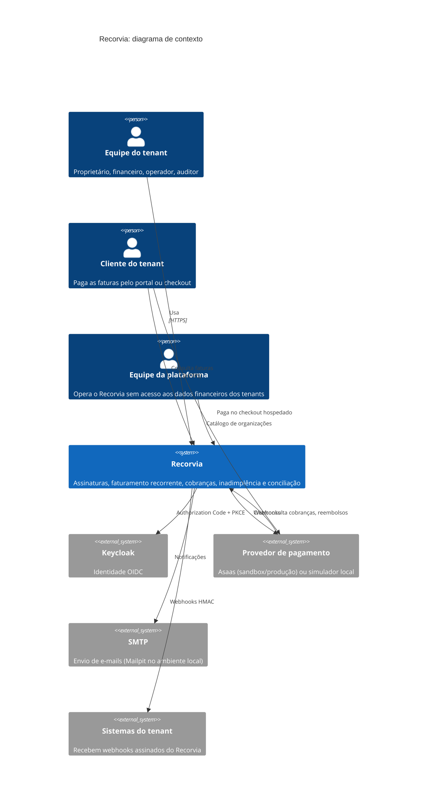
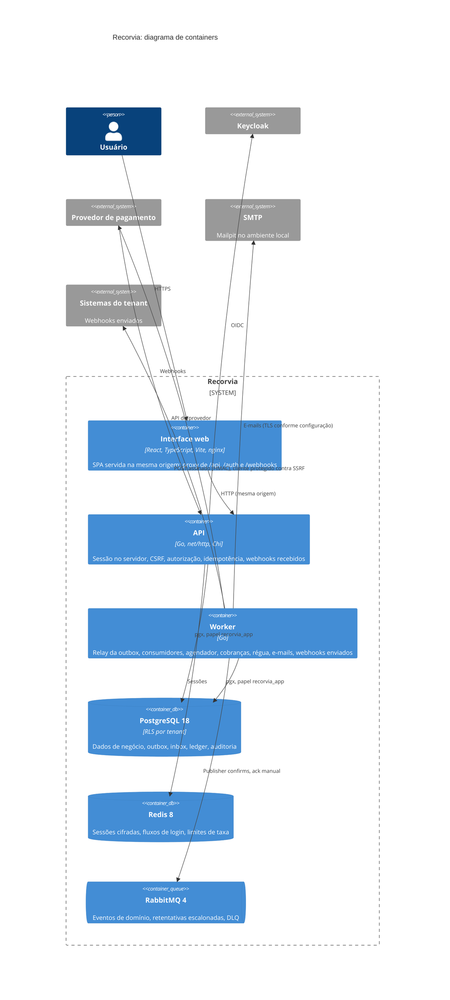

# Visão geral da arquitetura

## C4: contexto

## C4: containers

## Módulos

| Módulo | Responsabilidade | Depende de |
|---|---|---|
| `kernel/*` | dinheiro, calendário, relógio, erros, IDs, CPF/CNPJ | — |
| `tenancy` | organizações, membros, convites, papéis e permissões | `platformbilling` |
| `identity` | OIDC, sessões, CSRF | — |
| `apicredentials` | credenciais de API com escopos, rotação, revogação e autenticação Bearer | `tenancy`, `platformbilling` |
| `portal` | links de uso único, sessão restrita, faturas e preferências de contato do portal do cliente | `customers`, `tenancy`, `billing` |
| `platformbilling` | plano do tenant no Recorvia, limites, implantação assistida | — |
| `customers` | clientes, contatos, endereço | `tenancy` (e-mail) |
| `catalog` | produtos, métricas, planos, versões de preço | — |
| `subscriptions` | ciclo de vida das assinaturas | `catalog`, `customers`, `platformbilling` |
| `billing` | faturas, motor de recorrência, créditos | `subscriptions`, `catalog`, `customers`, `ledger` |
| `payments` | cobranças, operações externas, webhooks, recebimentos | `billing`, `ledger` |
| `ledger` | partidas dobradas | — |
| `reporting` | indicadores do dashboard (fórmulas em `indicadores.md`) | — |
| `notifications` | templates, notificações por e-mail com identidade de negócio, envio com lease | `billing`, `tenancy`, `platformbilling` |
| `collections` | políticas de cobrança, régua, inadimplência, suspensão e reativação | `notifications`, `subscriptions`, `platformbilling` |
| `webhooks` | webhooks enviados: endpoints, segredos, entregas e retentativas | `platformbilling` |
| `audit`, `outbox` | trilha imutável e eventos | — |

Adaptadores: `pgstore` (PostgreSQL via sqlc), `httpapi` (HTTP), `payments/gateways/*`
(provedores), `infra/*` (RabbitMQ, Redis, SMTP em `infra/mailer`, cliente HTTP protegido contra SSRF
em `infra/safehttp`, telemetria). A composição fica em `internal/app`.

### Comunicação entre módulos

- **Na mesma transação**: casos de uso recebem uma porta `Tx` do próprio módulo; o adaptador
  `pgstore` implementa todas sobre a mesma transação pgx com contexto de tenant. Assim, fatura,
  ledger, outbox e auditoria são atômicos.
- **Assíncrona**: eventos de domínio (`invoice.issued`, `provider_webhook.received`,
  `invoice.voided`...) passam pela outbox e pelo RabbitMQ; consumidores deduplicam pelo inbox.

### Separação futura

Os limites que permitiriam extrair serviços sem reescrever regras:

1. **Pagamentos**: já se comunica por eventos (`invoice.issued` → cobrança; `payment.confirmed` →
   fatura). A extração exigiria trocar a aplicação síncrona do pagamento à fatura por um
   evento consumido pelo faturamento.
2. **Notificações e webhooks enviados**: consomem eventos e não alteram estado financeiro; são os
   primeiros candidatos.
3. **Medição de consumo**: a ingestão pode ser isolada atrás de uma fila; o fechamento dos agregados
   continua no faturamento.
4. **Ledger**: pode virar serviço com API de lançamento idempotente (a chave de idempotência já
   existe em cada lançamento).

Cada extração exigiria banco próprio por serviço e contratos de eventos versionados; por isso não
há microsserviços nesta versão.

## Executáveis

| Executável | Função |
|---|---|
| `cmd/api` | HTTP: autenticação, sessões, endpoints, recepção de webhooks |
| `cmd/worker` | relay da outbox, consumidores, agendador, recuperação de operações, régua de cobrança, envio de e-mails e entrega de webhooks |
| `cmd/migrate` | bootstrap de papéis (superusuário) e migrations (dono) |
| `cmd/seed` | dados de demonstração idempotentes |
| `cmd/paysim` | provedor de pagamento simulado |
